# Question flow (derived from the logic model)

Preview build, not approved. Synthetic data only. Model `cough_fast_breathing` v1, modelSha `ade819699397846e36390e803232c81226724585d68b0d7c61deb6d0e1852deb`, flow derivation version `flow-2-is_no`. The compiled form in `project/` uses **flowMode minimal**.

The form asks one question per screen and only the questions that can still change the outcome. The flow is
computed from the rule table by code (it is not part of the signed model) and checked on every one of the
6400 answer combinations of the exact grid: the short form gives the same outcome as answering everything.

**Clinician's choice.** The minimal flow never asks danger-sign questions once the outcome is already decided, for
example for a child outside 2 to 59 months: a 1-month-old with convulsions is referred (outside the age range) without
anyone being asked about convulsions. `danger_signs_always` asks every danger-sign question in every case for that reason.

| flow mode | average questions (grid) | average questions (15 golden cases) | always asked | sometimes skipped | never asked | tree nodes / leaves | mismatches (tree / compiled) |
| --- | --- | --- | --- | --- | --- | --- | --- |
| minimal | 4.67 | 6.75 | age_months, cough | 7 questions | none | 153 / 78 | 0 / 0 |
| danger_signs_always | 8.20 | 8.20 | age_months, cough, convulsions, not_able_to_drink_or_feed, vomits_everything, chest_indrawing, unusually_sleepy | 2 questions | none | 261 / 78 | 0 / 0 |
| full | 8.92 | 8.30 | (authored shown_when only) | | | | |

Grid averages weight every answer combination equally (half of them have an out-of-range age), not real patients.

## Questions asked per golden case

| case | description | minimal | danger_signs_always | full |
| --- | --- | --- | --- | --- |
| g01 | 6 months, 52 breaths | 9 | 9 | 9 |
| g02 | 6 months, exactly 50 breaths | 9 | 9 | 9 |
| g03 | 6 months, 49 breaths | 9 | 9 | 9 |
| g04 | 11 months, 45 breaths | 9 | 9 | 9 |
| g05 | Exactly 12 months, 40 breaths | 9 | 9 | 9 |
| g06 | 12 months, 39 breaths | 9 | 9 | 9 |
| g07 | 59 months, 40 breaths | 9 | 9 | 9 |
| g08 | 60 months, no cough | 7 | 7 | 7 |
| g09 | 1 month, no cough | 7 | 7 | 7 |
| g10 | Cough 14 days, no fast breathing | 5 | 9 | 9 |
| g11 | Cough 14 days with fast breathing | 5 | 9 | 9 |
| g12 | Chest indrawing alone | 6 | 7 | 7 |
| g13 | No cough, convulsions | 4 | 7 | 7 |
| g14 | No cough, no signs | 7 | 7 | 7 |
| g15 | Outside the age range with a danger sign: 1 month old with convulsions | 3 | 7 | 7 |
| g16 | 6 months, convulsions and 55 breaths (danger sign with fast breathing in an infant) | 6 | 9 | 9 |
| g17 | Outside the age range with a danger sign: 1 month old with chest indrawing | 6 | 7 | 7 |
| g18 | 60 months with convulsions (outside the age range, danger sign) | 4 | 8 | 9 |
| g19 | 1 month, cough 14 days (outside the age range, danger sign from long cough) | 3 | 8 | 9 |
| g20 | 2 months, 49 breaths, no signs (youngest covered age) | 9 | 9 | 9 |

## minimal: only questions that can still change the outcome

- The form starts by asking "Child's age in months".
- Always asked: "Child's age in months", "Does the child have a cough?".
- Asked only when the answer can still change the result: "For how many days has the child had the cough?", "Has the child had convulsions?", "Is the child not able to drink or feed anything?", "Does the child vomit everything?", "Look: does the child have chest indrawing?", "Count the child's breaths in 1 minute", "Look: is the child unusually sleepy or unconscious?".

### How the form can end

<details><summary><strong>Danger sign, outside this form's age range: refer urgently. Give no medicine from this form.</strong> (11 ways)</summary>

- "Child's age in months" is under 2 months or 60 months or more, and "Does the child have a cough?" is yes, and "For how many days has the child had the cough?" is under 14 days, and "Has the child had convulsions?" is yes
- "Child's age in months" is under 2 months or 60 months or more, and "Does the child have a cough?" is yes, and "For how many days has the child had the cough?" is under 14 days, and "Has the child had convulsions?" is no, and "Is the child not able to drink or feed anything?" is yes
- "Child's age in months" is under 2 months or 60 months or more, and "Does the child have a cough?" is yes, and "For how many days has the child had the cough?" is under 14 days, and "Has the child had convulsions?" is no, and "Is the child not able to drink or feed anything?" is no, and "Does the child vomit everything?" is yes
- "Child's age in months" is under 2 months or 60 months or more, and "Does the child have a cough?" is yes, and "For how many days has the child had the cough?" is under 14 days, and "Has the child had convulsions?" is no, and "Is the child not able to drink or feed anything?" is no, and "Does the child vomit everything?" is no, and "Look: does the child have chest indrawing?" is yes
- "Child's age in months" is under 2 months or 60 months or more, and "Does the child have a cough?" is yes, and "For how many days has the child had the cough?" is under 14 days, and "Has the child had convulsions?" is no, and "Is the child not able to drink or feed anything?" is no, and "Does the child vomit everything?" is no, and "Look: does the child have chest indrawing?" is no, and "Look: is the child unusually sleepy or unconscious?" is yes
- "Child's age in months" is under 2 months or 60 months or more, and "Does the child have a cough?" is yes, and "For how many days has the child had the cough?" is 14 days or more
- "Child's age in months" is under 2 months or 60 months or more, and "Does the child have a cough?" is no, and "Has the child had convulsions?" is yes
- "Child's age in months" is under 2 months or 60 months or more, and "Does the child have a cough?" is no, and "Has the child had convulsions?" is no, and "Is the child not able to drink or feed anything?" is yes
- "Child's age in months" is under 2 months or 60 months or more, and "Does the child have a cough?" is no, and "Has the child had convulsions?" is no, and "Is the child not able to drink or feed anything?" is no, and "Does the child vomit everything?" is yes
- "Child's age in months" is under 2 months or 60 months or more, and "Does the child have a cough?" is no, and "Has the child had convulsions?" is no, and "Is the child not able to drink or feed anything?" is no, and "Does the child vomit everything?" is no, and "Look: does the child have chest indrawing?" is yes
- "Child's age in months" is under 2 months or 60 months or more, and "Does the child have a cough?" is no, and "Has the child had convulsions?" is no, and "Is the child not able to drink or feed anything?" is no, and "Does the child vomit everything?" is no, and "Look: does the child have chest indrawing?" is no, and "Look: is the child unusually sleepy or unconscious?" is yes

</details>

<details><summary><strong>Outside this form's age range, no danger sign: refer to health facility</strong> (2 ways)</summary>

- "Child's age in months" is under 2 months or 60 months or more, and "Does the child have a cough?" is yes, and "For how many days has the child had the cough?" is under 14 days, and "Has the child had convulsions?" is no, and "Is the child not able to drink or feed anything?" is no, and "Does the child vomit everything?" is no, and "Look: does the child have chest indrawing?" is no, and "Look: is the child unusually sleepy or unconscious?" is no
- "Child's age in months" is under 2 months or 60 months or more, and "Does the child have a cough?" is no, and "Has the child had convulsions?" is no, and "Is the child not able to drink or feed anything?" is no, and "Does the child vomit everything?" is no, and "Look: does the child have chest indrawing?" is no, and "Look: is the child unusually sleepy or unconscious?" is no

</details>

<details><summary><strong>Danger sign: refer urgently and give first dose of antibiotic</strong> (28 ways)</summary>

- "Child's age in months" is 2 to 11 months, and "Does the child have a cough?" is yes, and "For how many days has the child had the cough?" is under 14 days, and "Has the child had convulsions?" is yes, and "Look: does the child have chest indrawing?" is yes
- "Child's age in months" is 2 to 11 months, and "Does the child have a cough?" is yes, and "For how many days has the child had the cough?" is under 14 days, and "Has the child had convulsions?" is yes, and "Look: does the child have chest indrawing?" is no, and "Count the child's breaths in 1 minute" is 50 breaths per minute or more
- "Child's age in months" is 2 to 11 months, and "Does the child have a cough?" is yes, and "For how many days has the child had the cough?" is under 14 days, and "Has the child had convulsions?" is no, and "Is the child not able to drink or feed anything?" is yes, and "Look: does the child have chest indrawing?" is yes
- "Child's age in months" is 2 to 11 months, and "Does the child have a cough?" is yes, and "For how many days has the child had the cough?" is under 14 days, and "Has the child had convulsions?" is no, and "Is the child not able to drink or feed anything?" is yes, and "Look: does the child have chest indrawing?" is no, and "Count the child's breaths in 1 minute" is 50 breaths per minute or more
- "Child's age in months" is 2 to 11 months, and "Does the child have a cough?" is yes, and "For how many days has the child had the cough?" is under 14 days, and "Has the child had convulsions?" is no, and "Is the child not able to drink or feed anything?" is no, and "Does the child vomit everything?" is yes, and "Look: does the child have chest indrawing?" is yes
- "Child's age in months" is 2 to 11 months, and "Does the child have a cough?" is yes, and "For how many days has the child had the cough?" is under 14 days, and "Has the child had convulsions?" is no, and "Is the child not able to drink or feed anything?" is no, and "Does the child vomit everything?" is yes, and "Look: does the child have chest indrawing?" is no, and "Count the child's breaths in 1 minute" is 50 breaths per minute or more
- "Child's age in months" is 2 to 11 months, and "Does the child have a cough?" is yes, and "For how many days has the child had the cough?" is under 14 days, and "Has the child had convulsions?" is no, and "Is the child not able to drink or feed anything?" is no, and "Does the child vomit everything?" is no, and "Look: does the child have chest indrawing?" is yes
- "Child's age in months" is 2 to 11 months, and "Does the child have a cough?" is yes, and "For how many days has the child had the cough?" is under 14 days, and "Has the child had convulsions?" is no, and "Is the child not able to drink or feed anything?" is no, and "Does the child vomit everything?" is no, and "Look: does the child have chest indrawing?" is no, and "Count the child's breaths in 1 minute" is 50 breaths per minute or more, and "Look: is the child unusually sleepy or unconscious?" is yes
- "Child's age in months" is 2 to 11 months, and "Does the child have a cough?" is yes, and "For how many days has the child had the cough?" is 14 days or more, and "Look: does the child have chest indrawing?" is yes
- "Child's age in months" is 2 to 11 months, and "Does the child have a cough?" is yes, and "For how many days has the child had the cough?" is 14 days or more, and "Look: does the child have chest indrawing?" is no, and "Count the child's breaths in 1 minute" is 50 breaths per minute or more
- "Child's age in months" is 2 to 11 months, and "Does the child have a cough?" is no, and "Has the child had convulsions?" is yes, and "Look: does the child have chest indrawing?" is yes
- "Child's age in months" is 2 to 11 months, and "Does the child have a cough?" is no, and "Has the child had convulsions?" is no, and "Is the child not able to drink or feed anything?" is yes, and "Look: does the child have chest indrawing?" is yes
- "Child's age in months" is 2 to 11 months, and "Does the child have a cough?" is no, and "Has the child had convulsions?" is no, and "Is the child not able to drink or feed anything?" is no, and "Does the child vomit everything?" is yes, and "Look: does the child have chest indrawing?" is yes
- "Child's age in months" is 2 to 11 months, and "Does the child have a cough?" is no, and "Has the child had convulsions?" is no, and "Is the child not able to drink or feed anything?" is no, and "Does the child vomit everything?" is no, and "Look: does the child have chest indrawing?" is yes
- "Child's age in months" is 12 to 59 months, and "Does the child have a cough?" is yes, and "For how many days has the child had the cough?" is under 14 days, and "Has the child had convulsions?" is yes, and "Look: does the child have chest indrawing?" is yes
- "Child's age in months" is 12 to 59 months, and "Does the child have a cough?" is yes, and "For how many days has the child had the cough?" is under 14 days, and "Has the child had convulsions?" is yes, and "Look: does the child have chest indrawing?" is no, and "Count the child's breaths in 1 minute" is 40 breaths per minute or more
- "Child's age in months" is 12 to 59 months, and "Does the child have a cough?" is yes, and "For how many days has the child had the cough?" is under 14 days, and "Has the child had convulsions?" is no, and "Is the child not able to drink or feed anything?" is yes, and "Look: does the child have chest indrawing?" is yes
- "Child's age in months" is 12 to 59 months, and "Does the child have a cough?" is yes, and "For how many days has the child had the cough?" is under 14 days, and "Has the child had convulsions?" is no, and "Is the child not able to drink or feed anything?" is yes, and "Look: does the child have chest indrawing?" is no, and "Count the child's breaths in 1 minute" is 40 breaths per minute or more
- "Child's age in months" is 12 to 59 months, and "Does the child have a cough?" is yes, and "For how many days has the child had the cough?" is under 14 days, and "Has the child had convulsions?" is no, and "Is the child not able to drink or feed anything?" is no, and "Does the child vomit everything?" is yes, and "Look: does the child have chest indrawing?" is yes
- "Child's age in months" is 12 to 59 months, and "Does the child have a cough?" is yes, and "For how many days has the child had the cough?" is under 14 days, and "Has the child had convulsions?" is no, and "Is the child not able to drink or feed anything?" is no, and "Does the child vomit everything?" is yes, and "Look: does the child have chest indrawing?" is no, and "Count the child's breaths in 1 minute" is 40 breaths per minute or more
- "Child's age in months" is 12 to 59 months, and "Does the child have a cough?" is yes, and "For how many days has the child had the cough?" is under 14 days, and "Has the child had convulsions?" is no, and "Is the child not able to drink or feed anything?" is no, and "Does the child vomit everything?" is no, and "Look: does the child have chest indrawing?" is yes
- "Child's age in months" is 12 to 59 months, and "Does the child have a cough?" is yes, and "For how many days has the child had the cough?" is under 14 days, and "Has the child had convulsions?" is no, and "Is the child not able to drink or feed anything?" is no, and "Does the child vomit everything?" is no, and "Look: does the child have chest indrawing?" is no, and "Count the child's breaths in 1 minute" is 40 breaths per minute or more, and "Look: is the child unusually sleepy or unconscious?" is yes
- "Child's age in months" is 12 to 59 months, and "Does the child have a cough?" is yes, and "For how many days has the child had the cough?" is 14 days or more, and "Look: does the child have chest indrawing?" is yes
- "Child's age in months" is 12 to 59 months, and "Does the child have a cough?" is yes, and "For how many days has the child had the cough?" is 14 days or more, and "Look: does the child have chest indrawing?" is no, and "Count the child's breaths in 1 minute" is 40 breaths per minute or more
- "Child's age in months" is 12 to 59 months, and "Does the child have a cough?" is no, and "Has the child had convulsions?" is yes, and "Look: does the child have chest indrawing?" is yes
- "Child's age in months" is 12 to 59 months, and "Does the child have a cough?" is no, and "Has the child had convulsions?" is no, and "Is the child not able to drink or feed anything?" is yes, and "Look: does the child have chest indrawing?" is yes
- "Child's age in months" is 12 to 59 months, and "Does the child have a cough?" is no, and "Has the child had convulsions?" is no, and "Is the child not able to drink or feed anything?" is no, and "Does the child vomit everything?" is yes, and "Look: does the child have chest indrawing?" is yes
- "Child's age in months" is 12 to 59 months, and "Does the child have a cough?" is no, and "Has the child had convulsions?" is no, and "Is the child not able to drink or feed anything?" is no, and "Does the child vomit everything?" is no, and "Look: does the child have chest indrawing?" is yes

</details>

<details><summary><strong>Danger sign: refer urgently</strong> (18 ways)</summary>

- "Child's age in months" is 2 to 11 months, and "Does the child have a cough?" is yes, and "For how many days has the child had the cough?" is under 14 days, and "Has the child had convulsions?" is yes, and "Look: does the child have chest indrawing?" is no, and "Count the child's breaths in 1 minute" is under 50 breaths per minute
- "Child's age in months" is 2 to 11 months, and "Does the child have a cough?" is yes, and "For how many days has the child had the cough?" is under 14 days, and "Has the child had convulsions?" is no, and "Is the child not able to drink or feed anything?" is yes, and "Look: does the child have chest indrawing?" is no, and "Count the child's breaths in 1 minute" is under 50 breaths per minute
- "Child's age in months" is 2 to 11 months, and "Does the child have a cough?" is yes, and "For how many days has the child had the cough?" is under 14 days, and "Has the child had convulsions?" is no, and "Is the child not able to drink or feed anything?" is no, and "Does the child vomit everything?" is yes, and "Look: does the child have chest indrawing?" is no, and "Count the child's breaths in 1 minute" is under 50 breaths per minute
- "Child's age in months" is 2 to 11 months, and "Does the child have a cough?" is yes, and "For how many days has the child had the cough?" is under 14 days, and "Has the child had convulsions?" is no, and "Is the child not able to drink or feed anything?" is no, and "Does the child vomit everything?" is no, and "Look: does the child have chest indrawing?" is no, and "Count the child's breaths in 1 minute" is under 50 breaths per minute, and "Look: is the child unusually sleepy or unconscious?" is yes
- "Child's age in months" is 2 to 11 months, and "Does the child have a cough?" is yes, and "For how many days has the child had the cough?" is 14 days or more, and "Look: does the child have chest indrawing?" is no, and "Count the child's breaths in 1 minute" is under 50 breaths per minute
- "Child's age in months" is 2 to 11 months, and "Does the child have a cough?" is no, and "Has the child had convulsions?" is yes, and "Look: does the child have chest indrawing?" is no
- "Child's age in months" is 2 to 11 months, and "Does the child have a cough?" is no, and "Has the child had convulsions?" is no, and "Is the child not able to drink or feed anything?" is yes, and "Look: does the child have chest indrawing?" is no
- "Child's age in months" is 2 to 11 months, and "Does the child have a cough?" is no, and "Has the child had convulsions?" is no, and "Is the child not able to drink or feed anything?" is no, and "Does the child vomit everything?" is yes, and "Look: does the child have chest indrawing?" is no
- "Child's age in months" is 2 to 11 months, and "Does the child have a cough?" is no, and "Has the child had convulsions?" is no, and "Is the child not able to drink or feed anything?" is no, and "Does the child vomit everything?" is no, and "Look: does the child have chest indrawing?" is no, and "Look: is the child unusually sleepy or unconscious?" is yes
- "Child's age in months" is 12 to 59 months, and "Does the child have a cough?" is yes, and "For how many days has the child had the cough?" is under 14 days, and "Has the child had convulsions?" is yes, and "Look: does the child have chest indrawing?" is no, and "Count the child's breaths in 1 minute" is under 40 breaths per minute
- "Child's age in months" is 12 to 59 months, and "Does the child have a cough?" is yes, and "For how many days has the child had the cough?" is under 14 days, and "Has the child had convulsions?" is no, and "Is the child not able to drink or feed anything?" is yes, and "Look: does the child have chest indrawing?" is no, and "Count the child's breaths in 1 minute" is under 40 breaths per minute
- "Child's age in months" is 12 to 59 months, and "Does the child have a cough?" is yes, and "For how many days has the child had the cough?" is under 14 days, and "Has the child had convulsions?" is no, and "Is the child not able to drink or feed anything?" is no, and "Does the child vomit everything?" is yes, and "Look: does the child have chest indrawing?" is no, and "Count the child's breaths in 1 minute" is under 40 breaths per minute
- "Child's age in months" is 12 to 59 months, and "Does the child have a cough?" is yes, and "For how many days has the child had the cough?" is under 14 days, and "Has the child had convulsions?" is no, and "Is the child not able to drink or feed anything?" is no, and "Does the child vomit everything?" is no, and "Look: does the child have chest indrawing?" is no, and "Count the child's breaths in 1 minute" is under 40 breaths per minute, and "Look: is the child unusually sleepy or unconscious?" is yes
- "Child's age in months" is 12 to 59 months, and "Does the child have a cough?" is yes, and "For how many days has the child had the cough?" is 14 days or more, and "Look: does the child have chest indrawing?" is no, and "Count the child's breaths in 1 minute" is under 40 breaths per minute
- "Child's age in months" is 12 to 59 months, and "Does the child have a cough?" is no, and "Has the child had convulsions?" is yes, and "Look: does the child have chest indrawing?" is no
- "Child's age in months" is 12 to 59 months, and "Does the child have a cough?" is no, and "Has the child had convulsions?" is no, and "Is the child not able to drink or feed anything?" is yes, and "Look: does the child have chest indrawing?" is no
- "Child's age in months" is 12 to 59 months, and "Does the child have a cough?" is no, and "Has the child had convulsions?" is no, and "Is the child not able to drink or feed anything?" is no, and "Does the child vomit everything?" is yes, and "Look: does the child have chest indrawing?" is no
- "Child's age in months" is 12 to 59 months, and "Does the child have a cough?" is no, and "Has the child had convulsions?" is no, and "Is the child not able to drink or feed anything?" is no, and "Does the child vomit everything?" is no, and "Look: does the child have chest indrawing?" is no, and "Look: is the child unusually sleepy or unconscious?" is yes

</details>

<details><summary><strong>Fast breathing (pneumonia): treat at home and follow up in 3 days</strong> (2 ways)</summary>

- "Child's age in months" is 2 to 11 months, and "Does the child have a cough?" is yes, and "For how many days has the child had the cough?" is under 14 days, and "Has the child had convulsions?" is no, and "Is the child not able to drink or feed anything?" is no, and "Does the child vomit everything?" is no, and "Look: does the child have chest indrawing?" is no, and "Count the child's breaths in 1 minute" is 50 breaths per minute or more, and "Look: is the child unusually sleepy or unconscious?" is no
- "Child's age in months" is 12 to 59 months, and "Does the child have a cough?" is yes, and "For how many days has the child had the cough?" is under 14 days, and "Has the child had convulsions?" is no, and "Is the child not able to drink or feed anything?" is no, and "Does the child vomit everything?" is no, and "Look: does the child have chest indrawing?" is no, and "Count the child's breaths in 1 minute" is 40 breaths per minute or more, and "Look: is the child unusually sleepy or unconscious?" is no

</details>

<details><summary><strong>Cough without fast breathing or danger signs</strong> (2 ways)</summary>

- "Child's age in months" is 2 to 11 months, and "Does the child have a cough?" is yes, and "For how many days has the child had the cough?" is under 14 days, and "Has the child had convulsions?" is no, and "Is the child not able to drink or feed anything?" is no, and "Does the child vomit everything?" is no, and "Look: does the child have chest indrawing?" is no, and "Count the child's breaths in 1 minute" is under 50 breaths per minute, and "Look: is the child unusually sleepy or unconscious?" is no
- "Child's age in months" is 12 to 59 months, and "Does the child have a cough?" is yes, and "For how many days has the child had the cough?" is under 14 days, and "Has the child had convulsions?" is no, and "Is the child not able to drink or feed anything?" is no, and "Does the child vomit everything?" is no, and "Look: does the child have chest indrawing?" is no, and "Count the child's breaths in 1 minute" is under 40 breaths per minute, and "Look: is the child unusually sleepy or unconscious?" is no

</details>

<details><summary><strong>No cough: this form does not apply. Assess other problems.</strong> (2 ways)</summary>

- "Child's age in months" is 2 to 11 months, and "Does the child have a cough?" is no, and "Has the child had convulsions?" is no, and "Is the child not able to drink or feed anything?" is no, and "Does the child vomit everything?" is no, and "Look: does the child have chest indrawing?" is no, and "Look: is the child unusually sleepy or unconscious?" is no
- "Child's age in months" is 12 to 59 months, and "Does the child have a cough?" is no, and "Has the child had convulsions?" is no, and "Is the child not able to drink or feed anything?" is no, and "Does the child vomit everything?" is no, and "Look: does the child have chest indrawing?" is no, and "Look: is the child unusually sleepy or unconscious?" is no

</details>

### Diagram



```mermaid
flowchart TD
  q0["Child's age in months"]
  q1["Does the child have a cough?"]
  q2["For how many days has the child had the cough?"]
  q3["Has the child had convulsions?"]
  out_refer_urgent_outside_age_range(["Danger sign, outside this form's age range: refer urgently. Give no medicine from this form."])
  q3 -- "yes" --> out_refer_urgent_outside_age_range
  q4["Is the child not able to drink or feed anything?"]
  q4 -- "yes" --> out_refer_urgent_outside_age_range
  q5["Does the child vomit everything?"]
  q5 -- "yes" --> out_refer_urgent_outside_age_range
  q6["Look: does the child have chest indrawing?"]
  q6 -- "yes" --> out_refer_urgent_outside_age_range
  q7["Look: is the child unusually sleepy or unconscious?"]
  q7 -- "yes" --> out_refer_urgent_outside_age_range
  out_refer_outside_age_range(["Outside this form's age range, no danger sign: refer to health facility"])
  q7 -- "no" --> out_refer_outside_age_range
  q6 -- "no" --> q7
  q5 -- "no" --> q6
  q4 -- "no" --> q5
  q3 -- "no" --> q4
  q2 -- "under 14 days" --> q3
  q2 -- "14 days or more" --> out_refer_urgent_outside_age_range
  q1 -- "yes" --> q2
  q8["Has the child had convulsions?"]
  q8 -- "yes" --> out_refer_urgent_outside_age_range
  q9["Is the child not able to drink or feed anything?"]
  q9 -- "yes" --> out_refer_urgent_outside_age_range
  q10["Does the child vomit everything?"]
  q10 -- "yes" --> out_refer_urgent_outside_age_range
  q11["Look: does the child have chest indrawing?"]
  q11 -- "yes" --> out_refer_urgent_outside_age_range
  q12["Look: is the child unusually sleepy or unconscious?"]
  q12 -- "yes" --> out_refer_urgent_outside_age_range
  q12 -- "no" --> out_refer_outside_age_range
  q11 -- "no" --> q12
  q10 -- "no" --> q11
  q9 -- "no" --> q10
  q8 -- "no" --> q9
  q1 -- "no" --> q8
  q0 -- "under 2 months" --> q1
  q13["Does the child have a cough?"]
  q14["For how many days has the child had the cough?"]
  q15["Has the child had convulsions?"]
  q16["Look: does the child have chest indrawing?"]
  out_refer_urgent_with_antibiotic(["Danger sign: refer urgently and give first dose of antibiotic"])
  q16 -- "yes" --> out_refer_urgent_with_antibiotic
  q17["Count the child's breaths in 1 minute"]
  out_refer_urgent(["Danger sign: refer urgently"])
  q17 -- "under 50 breaths per minute" --> out_refer_urgent
  q17 -- "50 breaths per minute or more" --> out_refer_urgent_with_antibiotic
  q16 -- "no" --> q17
  q15 -- "yes" --> q16
  q18["Is the child not able to drink or feed anything?"]
  q19["Look: does the child have chest indrawing?"]
  q19 -- "yes" --> out_refer_urgent_with_antibiotic
  q20["Count the child's breaths in 1 minute"]
  q20 -- "under 50 breaths per minute" --> out_refer_urgent
  q20 -- "50 breaths per minute or more" --> out_refer_urgent_with_antibiotic
  q19 -- "no" --> q20
  q18 -- "yes" --> q19
  q21["Does the child vomit everything?"]
  q22["Look: does the child have chest indrawing?"]
  q22 -- "yes" --> out_refer_urgent_with_antibiotic
  q23["Count the child's breaths in 1 minute"]
  q23 -- "under 50 breaths per minute" --> out_refer_urgent
  q23 -- "50 breaths per minute or more" --> out_refer_urgent_with_antibiotic
  q22 -- "no" --> q23
  q21 -- "yes" --> q22
  q24["Look: does the child have chest indrawing?"]
  q24 -- "yes" --> out_refer_urgent_with_antibiotic
  q25["Count the child's breaths in 1 minute"]
  q26["Look: is the child unusually sleepy or unconscious?"]
  q26 -- "yes" --> out_refer_urgent
  out_cough_no_fast_breathing(["Cough without fast breathing or danger signs"])
  q26 -- "no" --> out_cough_no_fast_breathing
  q25 -- "under 50 breaths per minute" --> q26
  q27["Look: is the child unusually sleepy or unconscious?"]
  q27 -- "yes" --> out_refer_urgent_with_antibiotic
  out_treat_fast_breathing_at_home(["Fast breathing (pneumonia): treat at home and follow up in 3 days"])
  q27 -- "no" --> out_treat_fast_breathing_at_home
  q25 -- "50 breaths per minute or more" --> q27
  q24 -- "no" --> q25
  q21 -- "no" --> q24
  q18 -- "no" --> q21
  q15 -- "no" --> q18
  q14 -- "under 14 days" --> q15
  q28["Look: does the child have chest indrawing?"]
  q28 -- "yes" --> out_refer_urgent_with_antibiotic
  q29["Count the child's breaths in 1 minute"]
  q29 -- "under 50 breaths per minute" --> out_refer_urgent
  q29 -- "50 breaths per minute or more" --> out_refer_urgent_with_antibiotic
  q28 -- "no" --> q29
  q14 -- "14 days or more" --> q28
  q13 -- "yes" --> q14
  q30["Has the child had convulsions?"]
  q31["Look: does the child have chest indrawing?"]
  q31 -- "yes" --> out_refer_urgent_with_antibiotic
  q31 -- "no" --> out_refer_urgent
  q30 -- "yes" --> q31
  q32["Is the child not able to drink or feed anything?"]
  q33["Look: does the child have chest indrawing?"]
  q33 -- "yes" --> out_refer_urgent_with_antibiotic
  q33 -- "no" --> out_refer_urgent
  q32 -- "yes" --> q33
  q34["Does the child vomit everything?"]
  q35["Look: does the child have chest indrawing?"]
  q35 -- "yes" --> out_refer_urgent_with_antibiotic
  q35 -- "no" --> out_refer_urgent
  q34 -- "yes" --> q35
  q36["Look: does the child have chest indrawing?"]
  q36 -- "yes" --> out_refer_urgent_with_antibiotic
  q37["Look: is the child unusually sleepy or unconscious?"]
  q37 -- "yes" --> out_refer_urgent
  out_no_cough(["No cough: this form does not apply. Assess other problems."])
  q37 -- "no" --> out_no_cough
  q36 -- "no" --> q37
  q34 -- "no" --> q36
  q32 -- "no" --> q34
  q30 -- "no" --> q32
  q13 -- "no" --> q30
  q0 -- "2 to 11 months" --> q13
  q38["Does the child have a cough?"]
  q39["For how many days has the child had the cough?"]
  q40["Has the child had convulsions?"]
  q41["Look: does the child have chest indrawing?"]
  q41 -- "yes" --> out_refer_urgent_with_antibiotic
  q42["Count the child's breaths in 1 minute"]
  q42 -- "under 40 breaths per minute" --> out_refer_urgent
  q42 -- "40 breaths per minute or more" --> out_refer_urgent_with_antibiotic
  q41 -- "no" --> q42
  q40 -- "yes" --> q41
  q43["Is the child not able to drink or feed anything?"]
  q44["Look: does the child have chest indrawing?"]
  q44 -- "yes" --> out_refer_urgent_with_antibiotic
  q45["Count the child's breaths in 1 minute"]
  q45 -- "under 40 breaths per minute" --> out_refer_urgent
  q45 -- "40 breaths per minute or more" --> out_refer_urgent_with_antibiotic
  q44 -- "no" --> q45
  q43 -- "yes" --> q44
  q46["Does the child vomit everything?"]
  q47["Look: does the child have chest indrawing?"]
  q47 -- "yes" --> out_refer_urgent_with_antibiotic
  q48["Count the child's breaths in 1 minute"]
  q48 -- "under 40 breaths per minute" --> out_refer_urgent
  q48 -- "40 breaths per minute or more" --> out_refer_urgent_with_antibiotic
  q47 -- "no" --> q48
  q46 -- "yes" --> q47
  q49["Look: does the child have chest indrawing?"]
  q49 -- "yes" --> out_refer_urgent_with_antibiotic
  q50["Count the child's breaths in 1 minute"]
  q51["Look: is the child unusually sleepy or unconscious?"]
  q51 -- "yes" --> out_refer_urgent
  q51 -- "no" --> out_cough_no_fast_breathing
  q50 -- "under 40 breaths per minute" --> q51
  q52["Look: is the child unusually sleepy or unconscious?"]
  q52 -- "yes" --> out_refer_urgent_with_antibiotic
  q52 -- "no" --> out_treat_fast_breathing_at_home
  q50 -- "40 breaths per minute or more" --> q52
  q49 -- "no" --> q50
  q46 -- "no" --> q49
  q43 -- "no" --> q46
  q40 -- "no" --> q43
  q39 -- "under 14 days" --> q40
  q53["Look: does the child have chest indrawing?"]
  q53 -- "yes" --> out_refer_urgent_with_antibiotic
  q54["Count the child's breaths in 1 minute"]
  q54 -- "under 40 breaths per minute" --> out_refer_urgent
  q54 -- "40 breaths per minute or more" --> out_refer_urgent_with_antibiotic
  q53 -- "no" --> q54
  q39 -- "14 days or more" --> q53
  q38 -- "yes" --> q39
  q55["Has the child had convulsions?"]
  q56["Look: does the child have chest indrawing?"]
  q56 -- "yes" --> out_refer_urgent_with_antibiotic
  q56 -- "no" --> out_refer_urgent
  q55 -- "yes" --> q56
  q57["Is the child not able to drink or feed anything?"]
  q58["Look: does the child have chest indrawing?"]
  q58 -- "yes" --> out_refer_urgent_with_antibiotic
  q58 -- "no" --> out_refer_urgent
  q57 -- "yes" --> q58
  q59["Does the child vomit everything?"]
  q60["Look: does the child have chest indrawing?"]
  q60 -- "yes" --> out_refer_urgent_with_antibiotic
  q60 -- "no" --> out_refer_urgent
  q59 -- "yes" --> q60
  q61["Look: does the child have chest indrawing?"]
  q61 -- "yes" --> out_refer_urgent_with_antibiotic
  q62["Look: is the child unusually sleepy or unconscious?"]
  q62 -- "yes" --> out_refer_urgent
  q62 -- "no" --> out_no_cough
  q61 -- "no" --> q62
  q59 -- "no" --> q61
  q57 -- "no" --> q59
  q55 -- "no" --> q57
  q38 -- "no" --> q55
  q0 -- "12 to 59 months" --> q38
  q63["Does the child have a cough?"]
  q64["For how many days has the child had the cough?"]
  q65["Has the child had convulsions?"]
  q65 -- "yes" --> out_refer_urgent_outside_age_range
  q66["Is the child not able to drink or feed anything?"]
  q66 -- "yes" --> out_refer_urgent_outside_age_range
  q67["Does the child vomit everything?"]
  q67 -- "yes" --> out_refer_urgent_outside_age_range
  q68["Look: does the child have chest indrawing?"]
  q68 -- "yes" --> out_refer_urgent_outside_age_range
  q69["Look: is the child unusually sleepy or unconscious?"]
  q69 -- "yes" --> out_refer_urgent_outside_age_range
  q69 -- "no" --> out_refer_outside_age_range
  q68 -- "no" --> q69
  q67 -- "no" --> q68
  q66 -- "no" --> q67
  q65 -- "no" --> q66
  q64 -- "under 14 days" --> q65
  q64 -- "14 days or more" --> out_refer_urgent_outside_age_range
  q63 -- "yes" --> q64
  q70["Has the child had convulsions?"]
  q70 -- "yes" --> out_refer_urgent_outside_age_range
  q71["Is the child not able to drink or feed anything?"]
  q71 -- "yes" --> out_refer_urgent_outside_age_range
  q72["Does the child vomit everything?"]
  q72 -- "yes" --> out_refer_urgent_outside_age_range
  q73["Look: does the child have chest indrawing?"]
  q73 -- "yes" --> out_refer_urgent_outside_age_range
  q74["Look: is the child unusually sleepy or unconscious?"]
  q74 -- "yes" --> out_refer_urgent_outside_age_range
  q74 -- "no" --> out_refer_outside_age_range
  q73 -- "no" --> q74
  q72 -- "no" --> q73
  q71 -- "no" --> q72
  q70 -- "no" --> q71
  q63 -- "no" --> q70
  q0 -- "60 months or more" --> q63
```

## danger_signs_always: as minimal, but every danger-sign question is always asked

- The form starts by asking "Child's age in months".
- Always asked: "Child's age in months", "Does the child have a cough?", "Has the child had convulsions?", "Is the child not able to drink or feed anything?", "Does the child vomit everything?", "Look: does the child have chest indrawing?", "Look: is the child unusually sleepy or unconscious?".
- Asked only when the answer can still change the result: "For how many days has the child had the cough?", "Count the child's breaths in 1 minute".
- Never skipped on purpose: "Does the child have a cough?", "For how many days has the child had the cough?", "Has the child had convulsions?", "Is the child not able to drink or feed anything?", "Does the child vomit everything?", "Look: does the child have chest indrawing?", "Look: is the child unusually sleepy or unconscious?".

### How the form can end

<details><summary><strong>Danger sign, outside this form's age range: refer urgently. Give no medicine from this form.</strong> (11 ways)</summary>

- "Child's age in months" is under 2 months or 60 months or more, and "Does the child have a cough?" is yes, and "For how many days has the child had the cough?" is under 14 days, and "Has the child had convulsions?" is yes
- "Child's age in months" is under 2 months or 60 months or more, and "Does the child have a cough?" is yes, and "For how many days has the child had the cough?" is under 14 days, and "Has the child had convulsions?" is no, and "Is the child not able to drink or feed anything?" is yes
- "Child's age in months" is under 2 months or 60 months or more, and "Does the child have a cough?" is yes, and "For how many days has the child had the cough?" is under 14 days, and "Has the child had convulsions?" is no, and "Is the child not able to drink or feed anything?" is no, and "Does the child vomit everything?" is yes
- "Child's age in months" is under 2 months or 60 months or more, and "Does the child have a cough?" is yes, and "For how many days has the child had the cough?" is under 14 days, and "Has the child had convulsions?" is no, and "Is the child not able to drink or feed anything?" is no, and "Does the child vomit everything?" is no, and "Look: does the child have chest indrawing?" is yes
- "Child's age in months" is under 2 months or 60 months or more, and "Does the child have a cough?" is yes, and "For how many days has the child had the cough?" is under 14 days, and "Has the child had convulsions?" is no, and "Is the child not able to drink or feed anything?" is no, and "Does the child vomit everything?" is no, and "Look: does the child have chest indrawing?" is no, and "Look: is the child unusually sleepy or unconscious?" is yes
- "Child's age in months" is under 2 months or 60 months or more, and "Does the child have a cough?" is yes, and "For how many days has the child had the cough?" is 14 days or more
- "Child's age in months" is under 2 months or 60 months or more, and "Does the child have a cough?" is no, and "Has the child had convulsions?" is yes
- "Child's age in months" is under 2 months or 60 months or more, and "Does the child have a cough?" is no, and "Has the child had convulsions?" is no, and "Is the child not able to drink or feed anything?" is yes
- "Child's age in months" is under 2 months or 60 months or more, and "Does the child have a cough?" is no, and "Has the child had convulsions?" is no, and "Is the child not able to drink or feed anything?" is no, and "Does the child vomit everything?" is yes
- "Child's age in months" is under 2 months or 60 months or more, and "Does the child have a cough?" is no, and "Has the child had convulsions?" is no, and "Is the child not able to drink or feed anything?" is no, and "Does the child vomit everything?" is no, and "Look: does the child have chest indrawing?" is yes
- "Child's age in months" is under 2 months or 60 months or more, and "Does the child have a cough?" is no, and "Has the child had convulsions?" is no, and "Is the child not able to drink or feed anything?" is no, and "Does the child vomit everything?" is no, and "Look: does the child have chest indrawing?" is no, and "Look: is the child unusually sleepy or unconscious?" is yes

</details>

<details><summary><strong>Outside this form's age range, no danger sign: refer to health facility</strong> (2 ways)</summary>

- "Child's age in months" is under 2 months or 60 months or more, and "Does the child have a cough?" is yes, and "For how many days has the child had the cough?" is under 14 days, and "Has the child had convulsions?" is no, and "Is the child not able to drink or feed anything?" is no, and "Does the child vomit everything?" is no, and "Look: does the child have chest indrawing?" is no, and "Look: is the child unusually sleepy or unconscious?" is no
- "Child's age in months" is under 2 months or 60 months or more, and "Does the child have a cough?" is no, and "Has the child had convulsions?" is no, and "Is the child not able to drink or feed anything?" is no, and "Does the child vomit everything?" is no, and "Look: does the child have chest indrawing?" is no, and "Look: is the child unusually sleepy or unconscious?" is no

</details>

<details><summary><strong>Danger sign: refer urgently and give first dose of antibiotic</strong> (28 ways)</summary>

- "Child's age in months" is 2 to 11 months, and "Does the child have a cough?" is yes, and "For how many days has the child had the cough?" is under 14 days, and "Has the child had convulsions?" is yes, and "Look: does the child have chest indrawing?" is yes
- "Child's age in months" is 2 to 11 months, and "Does the child have a cough?" is yes, and "For how many days has the child had the cough?" is under 14 days, and "Has the child had convulsions?" is yes, and "Look: does the child have chest indrawing?" is no, and "Count the child's breaths in 1 minute" is 50 breaths per minute or more
- "Child's age in months" is 2 to 11 months, and "Does the child have a cough?" is yes, and "For how many days has the child had the cough?" is under 14 days, and "Has the child had convulsions?" is no, and "Is the child not able to drink or feed anything?" is yes, and "Look: does the child have chest indrawing?" is yes
- "Child's age in months" is 2 to 11 months, and "Does the child have a cough?" is yes, and "For how many days has the child had the cough?" is under 14 days, and "Has the child had convulsions?" is no, and "Is the child not able to drink or feed anything?" is yes, and "Look: does the child have chest indrawing?" is no, and "Count the child's breaths in 1 minute" is 50 breaths per minute or more
- "Child's age in months" is 2 to 11 months, and "Does the child have a cough?" is yes, and "For how many days has the child had the cough?" is under 14 days, and "Has the child had convulsions?" is no, and "Is the child not able to drink or feed anything?" is no, and "Does the child vomit everything?" is yes, and "Look: does the child have chest indrawing?" is yes
- "Child's age in months" is 2 to 11 months, and "Does the child have a cough?" is yes, and "For how many days has the child had the cough?" is under 14 days, and "Has the child had convulsions?" is no, and "Is the child not able to drink or feed anything?" is no, and "Does the child vomit everything?" is yes, and "Look: does the child have chest indrawing?" is no, and "Count the child's breaths in 1 minute" is 50 breaths per minute or more
- "Child's age in months" is 2 to 11 months, and "Does the child have a cough?" is yes, and "For how many days has the child had the cough?" is under 14 days, and "Has the child had convulsions?" is no, and "Is the child not able to drink or feed anything?" is no, and "Does the child vomit everything?" is no, and "Look: does the child have chest indrawing?" is yes
- "Child's age in months" is 2 to 11 months, and "Does the child have a cough?" is yes, and "For how many days has the child had the cough?" is under 14 days, and "Has the child had convulsions?" is no, and "Is the child not able to drink or feed anything?" is no, and "Does the child vomit everything?" is no, and "Look: does the child have chest indrawing?" is no, and "Count the child's breaths in 1 minute" is 50 breaths per minute or more, and "Look: is the child unusually sleepy or unconscious?" is yes
- "Child's age in months" is 2 to 11 months, and "Does the child have a cough?" is yes, and "For how many days has the child had the cough?" is 14 days or more, and "Look: does the child have chest indrawing?" is yes
- "Child's age in months" is 2 to 11 months, and "Does the child have a cough?" is yes, and "For how many days has the child had the cough?" is 14 days or more, and "Look: does the child have chest indrawing?" is no, and "Count the child's breaths in 1 minute" is 50 breaths per minute or more
- "Child's age in months" is 2 to 11 months, and "Does the child have a cough?" is no, and "Has the child had convulsions?" is yes, and "Look: does the child have chest indrawing?" is yes
- "Child's age in months" is 2 to 11 months, and "Does the child have a cough?" is no, and "Has the child had convulsions?" is no, and "Is the child not able to drink or feed anything?" is yes, and "Look: does the child have chest indrawing?" is yes
- "Child's age in months" is 2 to 11 months, and "Does the child have a cough?" is no, and "Has the child had convulsions?" is no, and "Is the child not able to drink or feed anything?" is no, and "Does the child vomit everything?" is yes, and "Look: does the child have chest indrawing?" is yes
- "Child's age in months" is 2 to 11 months, and "Does the child have a cough?" is no, and "Has the child had convulsions?" is no, and "Is the child not able to drink or feed anything?" is no, and "Does the child vomit everything?" is no, and "Look: does the child have chest indrawing?" is yes
- "Child's age in months" is 12 to 59 months, and "Does the child have a cough?" is yes, and "For how many days has the child had the cough?" is under 14 days, and "Has the child had convulsions?" is yes, and "Look: does the child have chest indrawing?" is yes
- "Child's age in months" is 12 to 59 months, and "Does the child have a cough?" is yes, and "For how many days has the child had the cough?" is under 14 days, and "Has the child had convulsions?" is yes, and "Look: does the child have chest indrawing?" is no, and "Count the child's breaths in 1 minute" is 40 breaths per minute or more
- "Child's age in months" is 12 to 59 months, and "Does the child have a cough?" is yes, and "For how many days has the child had the cough?" is under 14 days, and "Has the child had convulsions?" is no, and "Is the child not able to drink or feed anything?" is yes, and "Look: does the child have chest indrawing?" is yes
- "Child's age in months" is 12 to 59 months, and "Does the child have a cough?" is yes, and "For how many days has the child had the cough?" is under 14 days, and "Has the child had convulsions?" is no, and "Is the child not able to drink or feed anything?" is yes, and "Look: does the child have chest indrawing?" is no, and "Count the child's breaths in 1 minute" is 40 breaths per minute or more
- "Child's age in months" is 12 to 59 months, and "Does the child have a cough?" is yes, and "For how many days has the child had the cough?" is under 14 days, and "Has the child had convulsions?" is no, and "Is the child not able to drink or feed anything?" is no, and "Does the child vomit everything?" is yes, and "Look: does the child have chest indrawing?" is yes
- "Child's age in months" is 12 to 59 months, and "Does the child have a cough?" is yes, and "For how many days has the child had the cough?" is under 14 days, and "Has the child had convulsions?" is no, and "Is the child not able to drink or feed anything?" is no, and "Does the child vomit everything?" is yes, and "Look: does the child have chest indrawing?" is no, and "Count the child's breaths in 1 minute" is 40 breaths per minute or more
- "Child's age in months" is 12 to 59 months, and "Does the child have a cough?" is yes, and "For how many days has the child had the cough?" is under 14 days, and "Has the child had convulsions?" is no, and "Is the child not able to drink or feed anything?" is no, and "Does the child vomit everything?" is no, and "Look: does the child have chest indrawing?" is yes
- "Child's age in months" is 12 to 59 months, and "Does the child have a cough?" is yes, and "For how many days has the child had the cough?" is under 14 days, and "Has the child had convulsions?" is no, and "Is the child not able to drink or feed anything?" is no, and "Does the child vomit everything?" is no, and "Look: does the child have chest indrawing?" is no, and "Count the child's breaths in 1 minute" is 40 breaths per minute or more, and "Look: is the child unusually sleepy or unconscious?" is yes
- "Child's age in months" is 12 to 59 months, and "Does the child have a cough?" is yes, and "For how many days has the child had the cough?" is 14 days or more, and "Look: does the child have chest indrawing?" is yes
- "Child's age in months" is 12 to 59 months, and "Does the child have a cough?" is yes, and "For how many days has the child had the cough?" is 14 days or more, and "Look: does the child have chest indrawing?" is no, and "Count the child's breaths in 1 minute" is 40 breaths per minute or more
- "Child's age in months" is 12 to 59 months, and "Does the child have a cough?" is no, and "Has the child had convulsions?" is yes, and "Look: does the child have chest indrawing?" is yes
- "Child's age in months" is 12 to 59 months, and "Does the child have a cough?" is no, and "Has the child had convulsions?" is no, and "Is the child not able to drink or feed anything?" is yes, and "Look: does the child have chest indrawing?" is yes
- "Child's age in months" is 12 to 59 months, and "Does the child have a cough?" is no, and "Has the child had convulsions?" is no, and "Is the child not able to drink or feed anything?" is no, and "Does the child vomit everything?" is yes, and "Look: does the child have chest indrawing?" is yes
- "Child's age in months" is 12 to 59 months, and "Does the child have a cough?" is no, and "Has the child had convulsions?" is no, and "Is the child not able to drink or feed anything?" is no, and "Does the child vomit everything?" is no, and "Look: does the child have chest indrawing?" is yes

</details>

<details><summary><strong>Danger sign: refer urgently</strong> (18 ways)</summary>

- "Child's age in months" is 2 to 11 months, and "Does the child have a cough?" is yes, and "For how many days has the child had the cough?" is under 14 days, and "Has the child had convulsions?" is yes, and "Look: does the child have chest indrawing?" is no, and "Count the child's breaths in 1 minute" is under 50 breaths per minute
- "Child's age in months" is 2 to 11 months, and "Does the child have a cough?" is yes, and "For how many days has the child had the cough?" is under 14 days, and "Has the child had convulsions?" is no, and "Is the child not able to drink or feed anything?" is yes, and "Look: does the child have chest indrawing?" is no, and "Count the child's breaths in 1 minute" is under 50 breaths per minute
- "Child's age in months" is 2 to 11 months, and "Does the child have a cough?" is yes, and "For how many days has the child had the cough?" is under 14 days, and "Has the child had convulsions?" is no, and "Is the child not able to drink or feed anything?" is no, and "Does the child vomit everything?" is yes, and "Look: does the child have chest indrawing?" is no, and "Count the child's breaths in 1 minute" is under 50 breaths per minute
- "Child's age in months" is 2 to 11 months, and "Does the child have a cough?" is yes, and "For how many days has the child had the cough?" is under 14 days, and "Has the child had convulsions?" is no, and "Is the child not able to drink or feed anything?" is no, and "Does the child vomit everything?" is no, and "Look: does the child have chest indrawing?" is no, and "Count the child's breaths in 1 minute" is under 50 breaths per minute, and "Look: is the child unusually sleepy or unconscious?" is yes
- "Child's age in months" is 2 to 11 months, and "Does the child have a cough?" is yes, and "For how many days has the child had the cough?" is 14 days or more, and "Look: does the child have chest indrawing?" is no, and "Count the child's breaths in 1 minute" is under 50 breaths per minute
- "Child's age in months" is 2 to 11 months, and "Does the child have a cough?" is no, and "Has the child had convulsions?" is yes, and "Look: does the child have chest indrawing?" is no
- "Child's age in months" is 2 to 11 months, and "Does the child have a cough?" is no, and "Has the child had convulsions?" is no, and "Is the child not able to drink or feed anything?" is yes, and "Look: does the child have chest indrawing?" is no
- "Child's age in months" is 2 to 11 months, and "Does the child have a cough?" is no, and "Has the child had convulsions?" is no, and "Is the child not able to drink or feed anything?" is no, and "Does the child vomit everything?" is yes, and "Look: does the child have chest indrawing?" is no
- "Child's age in months" is 2 to 11 months, and "Does the child have a cough?" is no, and "Has the child had convulsions?" is no, and "Is the child not able to drink or feed anything?" is no, and "Does the child vomit everything?" is no, and "Look: does the child have chest indrawing?" is no, and "Look: is the child unusually sleepy or unconscious?" is yes
- "Child's age in months" is 12 to 59 months, and "Does the child have a cough?" is yes, and "For how many days has the child had the cough?" is under 14 days, and "Has the child had convulsions?" is yes, and "Look: does the child have chest indrawing?" is no, and "Count the child's breaths in 1 minute" is under 40 breaths per minute
- "Child's age in months" is 12 to 59 months, and "Does the child have a cough?" is yes, and "For how many days has the child had the cough?" is under 14 days, and "Has the child had convulsions?" is no, and "Is the child not able to drink or feed anything?" is yes, and "Look: does the child have chest indrawing?" is no, and "Count the child's breaths in 1 minute" is under 40 breaths per minute
- "Child's age in months" is 12 to 59 months, and "Does the child have a cough?" is yes, and "For how many days has the child had the cough?" is under 14 days, and "Has the child had convulsions?" is no, and "Is the child not able to drink or feed anything?" is no, and "Does the child vomit everything?" is yes, and "Look: does the child have chest indrawing?" is no, and "Count the child's breaths in 1 minute" is under 40 breaths per minute
- "Child's age in months" is 12 to 59 months, and "Does the child have a cough?" is yes, and "For how many days has the child had the cough?" is under 14 days, and "Has the child had convulsions?" is no, and "Is the child not able to drink or feed anything?" is no, and "Does the child vomit everything?" is no, and "Look: does the child have chest indrawing?" is no, and "Count the child's breaths in 1 minute" is under 40 breaths per minute, and "Look: is the child unusually sleepy or unconscious?" is yes
- "Child's age in months" is 12 to 59 months, and "Does the child have a cough?" is yes, and "For how many days has the child had the cough?" is 14 days or more, and "Look: does the child have chest indrawing?" is no, and "Count the child's breaths in 1 minute" is under 40 breaths per minute
- "Child's age in months" is 12 to 59 months, and "Does the child have a cough?" is no, and "Has the child had convulsions?" is yes, and "Look: does the child have chest indrawing?" is no
- "Child's age in months" is 12 to 59 months, and "Does the child have a cough?" is no, and "Has the child had convulsions?" is no, and "Is the child not able to drink or feed anything?" is yes, and "Look: does the child have chest indrawing?" is no
- "Child's age in months" is 12 to 59 months, and "Does the child have a cough?" is no, and "Has the child had convulsions?" is no, and "Is the child not able to drink or feed anything?" is no, and "Does the child vomit everything?" is yes, and "Look: does the child have chest indrawing?" is no
- "Child's age in months" is 12 to 59 months, and "Does the child have a cough?" is no, and "Has the child had convulsions?" is no, and "Is the child not able to drink or feed anything?" is no, and "Does the child vomit everything?" is no, and "Look: does the child have chest indrawing?" is no, and "Look: is the child unusually sleepy or unconscious?" is yes

</details>

<details><summary><strong>Fast breathing (pneumonia): treat at home and follow up in 3 days</strong> (2 ways)</summary>

- "Child's age in months" is 2 to 11 months, and "Does the child have a cough?" is yes, and "For how many days has the child had the cough?" is under 14 days, and "Has the child had convulsions?" is no, and "Is the child not able to drink or feed anything?" is no, and "Does the child vomit everything?" is no, and "Look: does the child have chest indrawing?" is no, and "Count the child's breaths in 1 minute" is 50 breaths per minute or more, and "Look: is the child unusually sleepy or unconscious?" is no
- "Child's age in months" is 12 to 59 months, and "Does the child have a cough?" is yes, and "For how many days has the child had the cough?" is under 14 days, and "Has the child had convulsions?" is no, and "Is the child not able to drink or feed anything?" is no, and "Does the child vomit everything?" is no, and "Look: does the child have chest indrawing?" is no, and "Count the child's breaths in 1 minute" is 40 breaths per minute or more, and "Look: is the child unusually sleepy or unconscious?" is no

</details>

<details><summary><strong>Cough without fast breathing or danger signs</strong> (2 ways)</summary>

- "Child's age in months" is 2 to 11 months, and "Does the child have a cough?" is yes, and "For how many days has the child had the cough?" is under 14 days, and "Has the child had convulsions?" is no, and "Is the child not able to drink or feed anything?" is no, and "Does the child vomit everything?" is no, and "Look: does the child have chest indrawing?" is no, and "Count the child's breaths in 1 minute" is under 50 breaths per minute, and "Look: is the child unusually sleepy or unconscious?" is no
- "Child's age in months" is 12 to 59 months, and "Does the child have a cough?" is yes, and "For how many days has the child had the cough?" is under 14 days, and "Has the child had convulsions?" is no, and "Is the child not able to drink or feed anything?" is no, and "Does the child vomit everything?" is no, and "Look: does the child have chest indrawing?" is no, and "Count the child's breaths in 1 minute" is under 40 breaths per minute, and "Look: is the child unusually sleepy or unconscious?" is no

</details>

<details><summary><strong>No cough: this form does not apply. Assess other problems.</strong> (2 ways)</summary>

- "Child's age in months" is 2 to 11 months, and "Does the child have a cough?" is no, and "Has the child had convulsions?" is no, and "Is the child not able to drink or feed anything?" is no, and "Does the child vomit everything?" is no, and "Look: does the child have chest indrawing?" is no, and "Look: is the child unusually sleepy or unconscious?" is no
- "Child's age in months" is 12 to 59 months, and "Does the child have a cough?" is no, and "Has the child had convulsions?" is no, and "Is the child not able to drink or feed anything?" is no, and "Does the child vomit everything?" is no, and "Look: does the child have chest indrawing?" is no, and "Look: is the child unusually sleepy or unconscious?" is no

</details>

### Diagram

```mermaid
flowchart TD
  q0["Child's age in months"]
  q1["Does the child have a cough?"]
  q2["For how many days has the child had the cough?"]
  q3["Has the child had convulsions?"]
  q4["Is the child not able to drink or feed anything?"]
  q5["Does the child vomit everything?"]
  q6["Look: does the child have chest indrawing?"]
  q7["Look: is the child unusually sleepy or unconscious?"]
  out_refer_urgent_outside_age_range(["Danger sign, outside this form's age range: refer urgently. Give no medicine from this form."])
  q7 -- "any answer" --> out_refer_urgent_outside_age_range
  q6 -- "any answer" --> q7
  q5 -- "any answer" --> q6
  q4 -- "any answer" --> q5
  q3 -- "yes" --> q4
  q8["Is the child not able to drink or feed anything?"]
  q9["Does the child vomit everything?"]
  q10["Look: does the child have chest indrawing?"]
  q11["Look: is the child unusually sleepy or unconscious?"]
  q11 -- "any answer" --> out_refer_urgent_outside_age_range
  q10 -- "any answer" --> q11
  q9 -- "any answer" --> q10
  q8 -- "yes" --> q9
  q12["Does the child vomit everything?"]
  q13["Look: does the child have chest indrawing?"]
  q14["Look: is the child unusually sleepy or unconscious?"]
  q14 -- "any answer" --> out_refer_urgent_outside_age_range
  q13 -- "any answer" --> q14
  q12 -- "yes" --> q13
  q15["Look: does the child have chest indrawing?"]
  q16["Look: is the child unusually sleepy or unconscious?"]
  q16 -- "any answer" --> out_refer_urgent_outside_age_range
  q15 -- "yes" --> q16
  q17["Look: is the child unusually sleepy or unconscious?"]
  q17 -- "yes" --> out_refer_urgent_outside_age_range
  out_refer_outside_age_range(["Outside this form's age range, no danger sign: refer to health facility"])
  q17 -- "no" --> out_refer_outside_age_range
  q15 -- "no" --> q17
  q12 -- "no" --> q15
  q8 -- "no" --> q12
  q3 -- "no" --> q8
  q2 -- "under 14 days" --> q3
  q18["Has the child had convulsions?"]
  q19["Is the child not able to drink or feed anything?"]
  q20["Does the child vomit everything?"]
  q21["Look: does the child have chest indrawing?"]
  q22["Look: is the child unusually sleepy or unconscious?"]
  q22 -- "any answer" --> out_refer_urgent_outside_age_range
  q21 -- "any answer" --> q22
  q20 -- "any answer" --> q21
  q19 -- "any answer" --> q20
  q18 -- "any answer" --> q19
  q2 -- "14 days or more" --> q18
  q1 -- "yes" --> q2
  q23["Has the child had convulsions?"]
  q24["Is the child not able to drink or feed anything?"]
  q25["Does the child vomit everything?"]
  q26["Look: does the child have chest indrawing?"]
  q27["Look: is the child unusually sleepy or unconscious?"]
  q27 -- "any answer" --> out_refer_urgent_outside_age_range
  q26 -- "any answer" --> q27
  q25 -- "any answer" --> q26
  q24 -- "any answer" --> q25
  q23 -- "yes" --> q24
  q28["Is the child not able to drink or feed anything?"]
  q29["Does the child vomit everything?"]
  q30["Look: does the child have chest indrawing?"]
  q31["Look: is the child unusually sleepy or unconscious?"]
  q31 -- "any answer" --> out_refer_urgent_outside_age_range
  q30 -- "any answer" --> q31
  q29 -- "any answer" --> q30
  q28 -- "yes" --> q29
  q32["Does the child vomit everything?"]
  q33["Look: does the child have chest indrawing?"]
  q34["Look: is the child unusually sleepy or unconscious?"]
  q34 -- "any answer" --> out_refer_urgent_outside_age_range
  q33 -- "any answer" --> q34
  q32 -- "yes" --> q33
  q35["Look: does the child have chest indrawing?"]
  q36["Look: is the child unusually sleepy or unconscious?"]
  q36 -- "any answer" --> out_refer_urgent_outside_age_range
  q35 -- "yes" --> q36
  q37["Look: is the child unusually sleepy or unconscious?"]
  q37 -- "yes" --> out_refer_urgent_outside_age_range
  q37 -- "no" --> out_refer_outside_age_range
  q35 -- "no" --> q37
  q32 -- "no" --> q35
  q28 -- "no" --> q32
  q23 -- "no" --> q28
  q1 -- "no" --> q23
  q0 -- "under 2 months" --> q1
  q38["Does the child have a cough?"]
  q39["For how many days has the child had the cough?"]
  q40["Has the child had convulsions?"]
  q41["Is the child not able to drink or feed anything?"]
  q42["Does the child vomit everything?"]
  q43["Look: does the child have chest indrawing?"]
  q44["Look: is the child unusually sleepy or unconscious?"]
  out_refer_urgent_with_antibiotic(["Danger sign: refer urgently and give first dose of antibiotic"])
  q44 -- "any answer" --> out_refer_urgent_with_antibiotic
  q43 -- "yes" --> q44
  q45["Count the child's breaths in 1 minute"]
  q46["Look: is the child unusually sleepy or unconscious?"]
  out_refer_urgent(["Danger sign: refer urgently"])
  q46 -- "any answer" --> out_refer_urgent
  q45 -- "under 50 breaths per minute" --> q46
  q47["Look: is the child unusually sleepy or unconscious?"]
  q47 -- "any answer" --> out_refer_urgent_with_antibiotic
  q45 -- "50 breaths per minute or more" --> q47
  q43 -- "no" --> q45
  q42 -- "any answer" --> q43
  q41 -- "any answer" --> q42
  q40 -- "yes" --> q41
  q48["Is the child not able to drink or feed anything?"]
  q49["Does the child vomit everything?"]
  q50["Look: does the child have chest indrawing?"]
  q51["Look: is the child unusually sleepy or unconscious?"]
  q51 -- "any answer" --> out_refer_urgent_with_antibiotic
  q50 -- "yes" --> q51
  q52["Count the child's breaths in 1 minute"]
  q53["Look: is the child unusually sleepy or unconscious?"]
  q53 -- "any answer" --> out_refer_urgent
  q52 -- "under 50 breaths per minute" --> q53
  q54["Look: is the child unusually sleepy or unconscious?"]
  q54 -- "any answer" --> out_refer_urgent_with_antibiotic
  q52 -- "50 breaths per minute or more" --> q54
  q50 -- "no" --> q52
  q49 -- "any answer" --> q50
  q48 -- "yes" --> q49
  q55["Does the child vomit everything?"]
  q56["Look: does the child have chest indrawing?"]
  q57["Look: is the child unusually sleepy or unconscious?"]
  q57 -- "any answer" --> out_refer_urgent_with_antibiotic
  q56 -- "yes" --> q57
  q58["Count the child's breaths in 1 minute"]
  q59["Look: is the child unusually sleepy or unconscious?"]
  q59 -- "any answer" --> out_refer_urgent
  q58 -- "under 50 breaths per minute" --> q59
  q60["Look: is the child unusually sleepy or unconscious?"]
  q60 -- "any answer" --> out_refer_urgent_with_antibiotic
  q58 -- "50 breaths per minute or more" --> q60
  q56 -- "no" --> q58
  q55 -- "yes" --> q56
  q61["Look: does the child have chest indrawing?"]
  q62["Look: is the child unusually sleepy or unconscious?"]
  q62 -- "any answer" --> out_refer_urgent_with_antibiotic
  q61 -- "yes" --> q62
  q63["Count the child's breaths in 1 minute"]
  q64["Look: is the child unusually sleepy or unconscious?"]
  q64 -- "yes" --> out_refer_urgent
  out_cough_no_fast_breathing(["Cough without fast breathing or danger signs"])
  q64 -- "no" --> out_cough_no_fast_breathing
  q63 -- "under 50 breaths per minute" --> q64
  q65["Look: is the child unusually sleepy or unconscious?"]
  q65 -- "yes" --> out_refer_urgent_with_antibiotic
  out_treat_fast_breathing_at_home(["Fast breathing (pneumonia): treat at home and follow up in 3 days"])
  q65 -- "no" --> out_treat_fast_breathing_at_home
  q63 -- "50 breaths per minute or more" --> q65
  q61 -- "no" --> q63
  q55 -- "no" --> q61
  q48 -- "no" --> q55
  q40 -- "no" --> q48
  q39 -- "under 14 days" --> q40
  q66["Has the child had convulsions?"]
  q67["Is the child not able to drink or feed anything?"]
  q68["Does the child vomit everything?"]
  q69["Look: does the child have chest indrawing?"]
  q70["Look: is the child unusually sleepy or unconscious?"]
  q70 -- "any answer" --> out_refer_urgent_with_antibiotic
  q69 -- "yes" --> q70
  q71["Count the child's breaths in 1 minute"]
  q72["Look: is the child unusually sleepy or unconscious?"]
  q72 -- "any answer" --> out_refer_urgent
  q71 -- "under 50 breaths per minute" --> q72
  q73["Look: is the child unusually sleepy or unconscious?"]
  q73 -- "any answer" --> out_refer_urgent_with_antibiotic
  q71 -- "50 breaths per minute or more" --> q73
  q69 -- "no" --> q71
  q68 -- "any answer" --> q69
  q67 -- "any answer" --> q68
  q66 -- "any answer" --> q67
  q39 -- "14 days or more" --> q66
  q38 -- "yes" --> q39
  q74["Has the child had convulsions?"]
  q75["Is the child not able to drink or feed anything?"]
  q76["Does the child vomit everything?"]
  q77["Look: does the child have chest indrawing?"]
  q78["Look: is the child unusually sleepy or unconscious?"]
  q78 -- "any answer" --> out_refer_urgent_with_antibiotic
  q77 -- "yes" --> q78
  q79["Look: is the child unusually sleepy or unconscious?"]
  q79 -- "any answer" --> out_refer_urgent
  q77 -- "no" --> q79
  q76 -- "any answer" --> q77
  q75 -- "any answer" --> q76
  q74 -- "yes" --> q75
  q80["Is the child not able to drink or feed anything?"]
  q81["Does the child vomit everything?"]
  q82["Look: does the child have chest indrawing?"]
  q83["Look: is the child unusually sleepy or unconscious?"]
  q83 -- "any answer" --> out_refer_urgent_with_antibiotic
  q82 -- "yes" --> q83
  q84["Look: is the child unusually sleepy or unconscious?"]
  q84 -- "any answer" --> out_refer_urgent
  q82 -- "no" --> q84
  q81 -- "any answer" --> q82
  q80 -- "yes" --> q81
  q85["Does the child vomit everything?"]
  q86["Look: does the child have chest indrawing?"]
  q87["Look: is the child unusually sleepy or unconscious?"]
  q87 -- "any answer" --> out_refer_urgent_with_antibiotic
  q86 -- "yes" --> q87
  q88["Look: is the child unusually sleepy or unconscious?"]
  q88 -- "any answer" --> out_refer_urgent
  q86 -- "no" --> q88
  q85 -- "yes" --> q86
  q89["Look: does the child have chest indrawing?"]
  q90["Look: is the child unusually sleepy or unconscious?"]
  q90 -- "any answer" --> out_refer_urgent_with_antibiotic
  q89 -- "yes" --> q90
  q91["Look: is the child unusually sleepy or unconscious?"]
  q91 -- "yes" --> out_refer_urgent
  out_no_cough(["No cough: this form does not apply. Assess other problems."])
  q91 -- "no" --> out_no_cough
  q89 -- "no" --> q91
  q85 -- "no" --> q89
  q80 -- "no" --> q85
  q74 -- "no" --> q80
  q38 -- "no" --> q74
  q0 -- "2 to 11 months" --> q38
  q92["Does the child have a cough?"]
  q93["For how many days has the child had the cough?"]
  q94["Has the child had convulsions?"]
  q95["Is the child not able to drink or feed anything?"]
  q96["Does the child vomit everything?"]
  q97["Look: does the child have chest indrawing?"]
  q98["Look: is the child unusually sleepy or unconscious?"]
  q98 -- "any answer" --> out_refer_urgent_with_antibiotic
  q97 -- "yes" --> q98
  q99["Count the child's breaths in 1 minute"]
  q100["Look: is the child unusually sleepy or unconscious?"]
  q100 -- "any answer" --> out_refer_urgent
  q99 -- "under 40 breaths per minute" --> q100
  q101["Look: is the child unusually sleepy or unconscious?"]
  q101 -- "any answer" --> out_refer_urgent_with_antibiotic
  q99 -- "40 breaths per minute or more" --> q101
  q97 -- "no" --> q99
  q96 -- "any answer" --> q97
  q95 -- "any answer" --> q96
  q94 -- "yes" --> q95
  q102["Is the child not able to drink or feed anything?"]
  q103["Does the child vomit everything?"]
  q104["Look: does the child have chest indrawing?"]
  q105["Look: is the child unusually sleepy or unconscious?"]
  q105 -- "any answer" --> out_refer_urgent_with_antibiotic
  q104 -- "yes" --> q105
  q106["Count the child's breaths in 1 minute"]
  q107["Look: is the child unusually sleepy or unconscious?"]
  q107 -- "any answer" --> out_refer_urgent
  q106 -- "under 40 breaths per minute" --> q107
  q108["Look: is the child unusually sleepy or unconscious?"]
  q108 -- "any answer" --> out_refer_urgent_with_antibiotic
  q106 -- "40 breaths per minute or more" --> q108
  q104 -- "no" --> q106
  q103 -- "any answer" --> q104
  q102 -- "yes" --> q103
  q109["Does the child vomit everything?"]
  q110["Look: does the child have chest indrawing?"]
  q111["Look: is the child unusually sleepy or unconscious?"]
  q111 -- "any answer" --> out_refer_urgent_with_antibiotic
  q110 -- "yes" --> q111
  q112["Count the child's breaths in 1 minute"]
  q113["Look: is the child unusually sleepy or unconscious?"]
  q113 -- "any answer" --> out_refer_urgent
  q112 -- "under 40 breaths per minute" --> q113
  q114["Look: is the child unusually sleepy or unconscious?"]
  q114 -- "any answer" --> out_refer_urgent_with_antibiotic
  q112 -- "40 breaths per minute or more" --> q114
  q110 -- "no" --> q112
  q109 -- "yes" --> q110
  q115["Look: does the child have chest indrawing?"]
  q116["Look: is the child unusually sleepy or unconscious?"]
  q116 -- "any answer" --> out_refer_urgent_with_antibiotic
  q115 -- "yes" --> q116
  q117["Count the child's breaths in 1 minute"]
  q118["Look: is the child unusually sleepy or unconscious?"]
  q118 -- "yes" --> out_refer_urgent
  q118 -- "no" --> out_cough_no_fast_breathing
  q117 -- "under 40 breaths per minute" --> q118
  q119["Look: is the child unusually sleepy or unconscious?"]
  q119 -- "yes" --> out_refer_urgent_with_antibiotic
  q119 -- "no" --> out_treat_fast_breathing_at_home
  q117 -- "40 breaths per minute or more" --> q119
  q115 -- "no" --> q117
  q109 -- "no" --> q115
  q102 -- "no" --> q109
  q94 -- "no" --> q102
  q93 -- "under 14 days" --> q94
  q120["Has the child had convulsions?"]
  q121["Is the child not able to drink or feed anything?"]
  q122["Does the child vomit everything?"]
  q123["Look: does the child have chest indrawing?"]
  q124["Look: is the child unusually sleepy or unconscious?"]
  q124 -- "any answer" --> out_refer_urgent_with_antibiotic
  q123 -- "yes" --> q124
  q125["Count the child's breaths in 1 minute"]
  q126["Look: is the child unusually sleepy or unconscious?"]
  q126 -- "any answer" --> out_refer_urgent
  q125 -- "under 40 breaths per minute" --> q126
  q127["Look: is the child unusually sleepy or unconscious?"]
  q127 -- "any answer" --> out_refer_urgent_with_antibiotic
  q125 -- "40 breaths per minute or more" --> q127
  q123 -- "no" --> q125
  q122 -- "any answer" --> q123
  q121 -- "any answer" --> q122
  q120 -- "any answer" --> q121
  q93 -- "14 days or more" --> q120
  q92 -- "yes" --> q93
  q128["Has the child had convulsions?"]
  q129["Is the child not able to drink or feed anything?"]
  q130["Does the child vomit everything?"]
  q131["Look: does the child have chest indrawing?"]
  q132["Look: is the child unusually sleepy or unconscious?"]
  q132 -- "any answer" --> out_refer_urgent_with_antibiotic
  q131 -- "yes" --> q132
  q133["Look: is the child unusually sleepy or unconscious?"]
  q133 -- "any answer" --> out_refer_urgent
  q131 -- "no" --> q133
  q130 -- "any answer" --> q131
  q129 -- "any answer" --> q130
  q128 -- "yes" --> q129
  q134["Is the child not able to drink or feed anything?"]
  q135["Does the child vomit everything?"]
  q136["Look: does the child have chest indrawing?"]
  q137["Look: is the child unusually sleepy or unconscious?"]
  q137 -- "any answer" --> out_refer_urgent_with_antibiotic
  q136 -- "yes" --> q137
  q138["Look: is the child unusually sleepy or unconscious?"]
  q138 -- "any answer" --> out_refer_urgent
  q136 -- "no" --> q138
  q135 -- "any answer" --> q136
  q134 -- "yes" --> q135
  q139["Does the child vomit everything?"]
  q140["Look: does the child have chest indrawing?"]
  q141["Look: is the child unusually sleepy or unconscious?"]
  q141 -- "any answer" --> out_refer_urgent_with_antibiotic
  q140 -- "yes" --> q141
  q142["Look: is the child unusually sleepy or unconscious?"]
  q142 -- "any answer" --> out_refer_urgent
  q140 -- "no" --> q142
  q139 -- "yes" --> q140
  q143["Look: does the child have chest indrawing?"]
  q144["Look: is the child unusually sleepy or unconscious?"]
  q144 -- "any answer" --> out_refer_urgent_with_antibiotic
  q143 -- "yes" --> q144
  q145["Look: is the child unusually sleepy or unconscious?"]
  q145 -- "yes" --> out_refer_urgent
  q145 -- "no" --> out_no_cough
  q143 -- "no" --> q145
  q139 -- "no" --> q143
  q134 -- "no" --> q139
  q128 -- "no" --> q134
  q92 -- "no" --> q128
  q0 -- "12 to 59 months" --> q92
  q146["Does the child have a cough?"]
  q147["For how many days has the child had the cough?"]
  q148["Has the child had convulsions?"]
  q149["Is the child not able to drink or feed anything?"]
  q150["Does the child vomit everything?"]
  q151["Look: does the child have chest indrawing?"]
  q152["Look: is the child unusually sleepy or unconscious?"]
  q152 -- "any answer" --> out_refer_urgent_outside_age_range
  q151 -- "any answer" --> q152
  q150 -- "any answer" --> q151
  q149 -- "any answer" --> q150
  q148 -- "yes" --> q149
  q153["Is the child not able to drink or feed anything?"]
  q154["Does the child vomit everything?"]
  q155["Look: does the child have chest indrawing?"]
  q156["Look: is the child unusually sleepy or unconscious?"]
  q156 -- "any answer" --> out_refer_urgent_outside_age_range
  q155 -- "any answer" --> q156
  q154 -- "any answer" --> q155
  q153 -- "yes" --> q154
  q157["Does the child vomit everything?"]
  q158["Look: does the child have chest indrawing?"]
  q159["Look: is the child unusually sleepy or unconscious?"]
  q159 -- "any answer" --> out_refer_urgent_outside_age_range
  q158 -- "any answer" --> q159
  q157 -- "yes" --> q158
  q160["Look: does the child have chest indrawing?"]
  q161["Look: is the child unusually sleepy or unconscious?"]
  q161 -- "any answer" --> out_refer_urgent_outside_age_range
  q160 -- "yes" --> q161
  q162["Look: is the child unusually sleepy or unconscious?"]
  q162 -- "yes" --> out_refer_urgent_outside_age_range
  q162 -- "no" --> out_refer_outside_age_range
  q160 -- "no" --> q162
  q157 -- "no" --> q160
  q153 -- "no" --> q157
  q148 -- "no" --> q153
  q147 -- "under 14 days" --> q148
  q163["Has the child had convulsions?"]
  q164["Is the child not able to drink or feed anything?"]
  q165["Does the child vomit everything?"]
  q166["Look: does the child have chest indrawing?"]
  q167["Look: is the child unusually sleepy or unconscious?"]
  q167 -- "any answer" --> out_refer_urgent_outside_age_range
  q166 -- "any answer" --> q167
  q165 -- "any answer" --> q166
  q164 -- "any answer" --> q165
  q163 -- "any answer" --> q164
  q147 -- "14 days or more" --> q163
  q146 -- "yes" --> q147
  q168["Has the child had convulsions?"]
  q169["Is the child not able to drink or feed anything?"]
  q170["Does the child vomit everything?"]
  q171["Look: does the child have chest indrawing?"]
  q172["Look: is the child unusually sleepy or unconscious?"]
  q172 -- "any answer" --> out_refer_urgent_outside_age_range
  q171 -- "any answer" --> q172
  q170 -- "any answer" --> q171
  q169 -- "any answer" --> q170
  q168 -- "yes" --> q169
  q173["Is the child not able to drink or feed anything?"]
  q174["Does the child vomit everything?"]
  q175["Look: does the child have chest indrawing?"]
  q176["Look: is the child unusually sleepy or unconscious?"]
  q176 -- "any answer" --> out_refer_urgent_outside_age_range
  q175 -- "any answer" --> q176
  q174 -- "any answer" --> q175
  q173 -- "yes" --> q174
  q177["Does the child vomit everything?"]
  q178["Look: does the child have chest indrawing?"]
  q179["Look: is the child unusually sleepy or unconscious?"]
  q179 -- "any answer" --> out_refer_urgent_outside_age_range
  q178 -- "any answer" --> q179
  q177 -- "yes" --> q178
  q180["Look: does the child have chest indrawing?"]
  q181["Look: is the child unusually sleepy or unconscious?"]
  q181 -- "any answer" --> out_refer_urgent_outside_age_range
  q180 -- "yes" --> q181
  q182["Look: is the child unusually sleepy or unconscious?"]
  q182 -- "yes" --> out_refer_urgent_outside_age_range
  q182 -- "no" --> out_refer_outside_age_range
  q180 -- "no" --> q182
  q177 -- "no" --> q180
  q173 -- "no" --> q177
  q168 -- "no" --> q173
  q146 -- "no" --> q168
  q0 -- "60 months or more" --> q146
```
