```mermaid
flowchart TD
  q0["Child's age in months"]
  q1["Does the child have a cough?"]
  q2["For how many days has the child had the cough?"]
  q3["Has the child had convulsions?"]
  q4["Is the child not able to drink or feed anything?"]
  q5["Does the child vomit everything?"]
  q6["Look: does the child have chest indrawing?"]
  q7["Look: is the child unusually sleepy or unconscious?"]
  out_refer_outside_age_range(["Refer to health facility: child is outside the age range this form covers"])
  q7 -- "any answer" --> out_refer_outside_age_range
  q6 -- "any answer" --> q7
  q5 -- "any answer" --> q6
  q4 -- "any answer" --> q5
  q3 -- "any answer" --> q4
  q2 -- "any answer" --> q3
  q1 -- "yes" --> q2
  q8["Has the child had convulsions?"]
  q9["Is the child not able to drink or feed anything?"]
  q10["Does the child vomit everything?"]
  q11["Look: does the child have chest indrawing?"]
  q12["Look: is the child unusually sleepy or unconscious?"]
  q12 -- "any answer" --> out_refer_outside_age_range
  q11 -- "any answer" --> q12
  q10 -- "any answer" --> q11
  q9 -- "any answer" --> q10
  q8 -- "any answer" --> q9
  q1 -- "no" --> q8
  q0 -- "under 2 months" --> q1
  q13["Does the child have a cough?"]
  q14["For how many days has the child had the cough?"]
  q15["Has the child had convulsions?"]
  q16["Is the child not able to drink or feed anything?"]
  q17["Does the child vomit everything?"]
  q18["Look: does the child have chest indrawing?"]
  q19["Look: is the child unusually sleepy or unconscious?"]
  out_refer_urgent_with_antibiotic(["Danger sign: refer urgently and give first dose of antibiotic"])
  q19 -- "any answer" --> out_refer_urgent_with_antibiotic
  q18 -- "yes" --> q19
  q20["Count the child's breaths in 1 minute"]
  q21["Look: is the child unusually sleepy or unconscious?"]
  out_refer_urgent(["Danger sign: refer urgently"])
  q21 -- "any answer" --> out_refer_urgent
  q20 -- "under 50 breaths per minute" --> q21
  q22["Look: is the child unusually sleepy or unconscious?"]
  q22 -- "any answer" --> out_refer_urgent_with_antibiotic
  q20 -- "50 breaths per minute or more" --> q22
  q18 -- "no" --> q20
  q17 -- "any answer" --> q18
  q16 -- "any answer" --> q17
  q15 -- "yes" --> q16
  q23["Is the child not able to drink or feed anything?"]
  q24["Does the child vomit everything?"]
  q25["Look: does the child have chest indrawing?"]
  q26["Look: is the child unusually sleepy or unconscious?"]
  q26 -- "any answer" --> out_refer_urgent_with_antibiotic
  q25 -- "yes" --> q26
  q27["Count the child's breaths in 1 minute"]
  q28["Look: is the child unusually sleepy or unconscious?"]
  q28 -- "any answer" --> out_refer_urgent
  q27 -- "under 50 breaths per minute" --> q28
  q29["Look: is the child unusually sleepy or unconscious?"]
  q29 -- "any answer" --> out_refer_urgent_with_antibiotic
  q27 -- "50 breaths per minute or more" --> q29
  q25 -- "no" --> q27
  q24 -- "any answer" --> q25
  q23 -- "yes" --> q24
  q30["Does the child vomit everything?"]
  q31["Look: does the child have chest indrawing?"]
  q32["Look: is the child unusually sleepy or unconscious?"]
  q32 -- "any answer" --> out_refer_urgent_with_antibiotic
  q31 -- "yes" --> q32
  q33["Count the child's breaths in 1 minute"]
  q34["Look: is the child unusually sleepy or unconscious?"]
  q34 -- "any answer" --> out_refer_urgent
  q33 -- "under 50 breaths per minute" --> q34
  q35["Look: is the child unusually sleepy or unconscious?"]
  q35 -- "any answer" --> out_refer_urgent_with_antibiotic
  q33 -- "50 breaths per minute or more" --> q35
  q31 -- "no" --> q33
  q30 -- "yes" --> q31
  q36["Look: does the child have chest indrawing?"]
  q37["Look: is the child unusually sleepy or unconscious?"]
  q37 -- "any answer" --> out_refer_urgent_with_antibiotic
  q36 -- "yes" --> q37
  q38["Count the child's breaths in 1 minute"]
  q39["Look: is the child unusually sleepy or unconscious?"]
  q39 -- "yes" --> out_refer_urgent
  out_cough_no_fast_breathing(["Cough without fast breathing or danger signs"])
  q39 -- "no" --> out_cough_no_fast_breathing
  q38 -- "under 50 breaths per minute" --> q39
  q40["Look: is the child unusually sleepy or unconscious?"]
  q40 -- "yes" --> out_refer_urgent_with_antibiotic
  out_treat_fast_breathing_at_home(["Fast breathing (pneumonia): treat at home and follow up in 3 days"])
  q40 -- "no" --> out_treat_fast_breathing_at_home
  q38 -- "50 breaths per minute or more" --> q40
  q36 -- "no" --> q38
  q30 -- "no" --> q36
  q23 -- "no" --> q30
  q15 -- "no" --> q23
  q14 -- "under 14 days" --> q15
  q41["Has the child had convulsions?"]
  q42["Is the child not able to drink or feed anything?"]
  q43["Does the child vomit everything?"]
  q44["Look: does the child have chest indrawing?"]
  q45["Look: is the child unusually sleepy or unconscious?"]
  q45 -- "any answer" --> out_refer_urgent_with_antibiotic
  q44 -- "yes" --> q45
  q46["Count the child's breaths in 1 minute"]
  q47["Look: is the child unusually sleepy or unconscious?"]
  q47 -- "any answer" --> out_refer_urgent
  q46 -- "under 50 breaths per minute" --> q47
  q48["Look: is the child unusually sleepy or unconscious?"]
  q48 -- "any answer" --> out_refer_urgent_with_antibiotic
  q46 -- "50 breaths per minute or more" --> q48
  q44 -- "no" --> q46
  q43 -- "any answer" --> q44
  q42 -- "any answer" --> q43
  q41 -- "any answer" --> q42
  q14 -- "14 days or more" --> q41
  q13 -- "yes" --> q14
  q49["Has the child had convulsions?"]
  q50["Is the child not able to drink or feed anything?"]
  q51["Does the child vomit everything?"]
  q52["Look: does the child have chest indrawing?"]
  q53["Look: is the child unusually sleepy or unconscious?"]
  q53 -- "any answer" --> out_refer_urgent_with_antibiotic
  q52 -- "yes" --> q53
  q54["Look: is the child unusually sleepy or unconscious?"]
  q54 -- "any answer" --> out_refer_urgent
  q52 -- "no" --> q54
  q51 -- "any answer" --> q52
  q50 -- "any answer" --> q51
  q49 -- "yes" --> q50
  q55["Is the child not able to drink or feed anything?"]
  q56["Does the child vomit everything?"]
  q57["Look: does the child have chest indrawing?"]
  q58["Look: is the child unusually sleepy or unconscious?"]
  q58 -- "any answer" --> out_refer_urgent_with_antibiotic
  q57 -- "yes" --> q58
  q59["Look: is the child unusually sleepy or unconscious?"]
  q59 -- "any answer" --> out_refer_urgent
  q57 -- "no" --> q59
  q56 -- "any answer" --> q57
  q55 -- "yes" --> q56
  q60["Does the child vomit everything?"]
  q61["Look: does the child have chest indrawing?"]
  q62["Look: is the child unusually sleepy or unconscious?"]
  q62 -- "any answer" --> out_refer_urgent_with_antibiotic
  q61 -- "yes" --> q62
  q63["Look: is the child unusually sleepy or unconscious?"]
  q63 -- "any answer" --> out_refer_urgent
  q61 -- "no" --> q63
  q60 -- "yes" --> q61
  q64["Look: does the child have chest indrawing?"]
  q65["Look: is the child unusually sleepy or unconscious?"]
  q65 -- "any answer" --> out_refer_urgent_with_antibiotic
  q64 -- "yes" --> q65
  q66["Look: is the child unusually sleepy or unconscious?"]
  q66 -- "yes" --> out_refer_urgent
  out_no_cough(["No cough: this form does not apply. Assess other problems."])
  q66 -- "no" --> out_no_cough
  q64 -- "no" --> q66
  q60 -- "no" --> q64
  q55 -- "no" --> q60
  q49 -- "no" --> q55
  q13 -- "no" --> q49
  q0 -- "2 to 11 months" --> q13
  q67["Does the child have a cough?"]
  q68["For how many days has the child had the cough?"]
  q69["Has the child had convulsions?"]
  q70["Is the child not able to drink or feed anything?"]
  q71["Does the child vomit everything?"]
  q72["Look: does the child have chest indrawing?"]
  q73["Look: is the child unusually sleepy or unconscious?"]
  q73 -- "any answer" --> out_refer_urgent_with_antibiotic
  q72 -- "yes" --> q73
  q74["Count the child's breaths in 1 minute"]
  q75["Look: is the child unusually sleepy or unconscious?"]
  q75 -- "any answer" --> out_refer_urgent
  q74 -- "under 40 breaths per minute" --> q75
  q76["Look: is the child unusually sleepy or unconscious?"]
  q76 -- "any answer" --> out_refer_urgent_with_antibiotic
  q74 -- "40 breaths per minute or more" --> q76
  q72 -- "no" --> q74
  q71 -- "any answer" --> q72
  q70 -- "any answer" --> q71
  q69 -- "yes" --> q70
  q77["Is the child not able to drink or feed anything?"]
  q78["Does the child vomit everything?"]
  q79["Look: does the child have chest indrawing?"]
  q80["Look: is the child unusually sleepy or unconscious?"]
  q80 -- "any answer" --> out_refer_urgent_with_antibiotic
  q79 -- "yes" --> q80
  q81["Count the child's breaths in 1 minute"]
  q82["Look: is the child unusually sleepy or unconscious?"]
  q82 -- "any answer" --> out_refer_urgent
  q81 -- "under 40 breaths per minute" --> q82
  q83["Look: is the child unusually sleepy or unconscious?"]
  q83 -- "any answer" --> out_refer_urgent_with_antibiotic
  q81 -- "40 breaths per minute or more" --> q83
  q79 -- "no" --> q81
  q78 -- "any answer" --> q79
  q77 -- "yes" --> q78
  q84["Does the child vomit everything?"]
  q85["Look: does the child have chest indrawing?"]
  q86["Look: is the child unusually sleepy or unconscious?"]
  q86 -- "any answer" --> out_refer_urgent_with_antibiotic
  q85 -- "yes" --> q86
  q87["Count the child's breaths in 1 minute"]
  q88["Look: is the child unusually sleepy or unconscious?"]
  q88 -- "any answer" --> out_refer_urgent
  q87 -- "under 40 breaths per minute" --> q88
  q89["Look: is the child unusually sleepy or unconscious?"]
  q89 -- "any answer" --> out_refer_urgent_with_antibiotic
  q87 -- "40 breaths per minute or more" --> q89
  q85 -- "no" --> q87
  q84 -- "yes" --> q85
  q90["Look: does the child have chest indrawing?"]
  q91["Look: is the child unusually sleepy or unconscious?"]
  q91 -- "any answer" --> out_refer_urgent_with_antibiotic
  q90 -- "yes" --> q91
  q92["Count the child's breaths in 1 minute"]
  q93["Look: is the child unusually sleepy or unconscious?"]
  q93 -- "yes" --> out_refer_urgent
  q93 -- "no" --> out_cough_no_fast_breathing
  q92 -- "under 40 breaths per minute" --> q93
  q94["Look: is the child unusually sleepy or unconscious?"]
  q94 -- "yes" --> out_refer_urgent_with_antibiotic
  q94 -- "no" --> out_treat_fast_breathing_at_home
  q92 -- "40 breaths per minute or more" --> q94
  q90 -- "no" --> q92
  q84 -- "no" --> q90
  q77 -- "no" --> q84
  q69 -- "no" --> q77
  q68 -- "under 14 days" --> q69
  q95["Has the child had convulsions?"]
  q96["Is the child not able to drink or feed anything?"]
  q97["Does the child vomit everything?"]
  q98["Look: does the child have chest indrawing?"]
  q99["Look: is the child unusually sleepy or unconscious?"]
  q99 -- "any answer" --> out_refer_urgent_with_antibiotic
  q98 -- "yes" --> q99
  q100["Count the child's breaths in 1 minute"]
  q101["Look: is the child unusually sleepy or unconscious?"]
  q101 -- "any answer" --> out_refer_urgent
  q100 -- "under 40 breaths per minute" --> q101
  q102["Look: is the child unusually sleepy or unconscious?"]
  q102 -- "any answer" --> out_refer_urgent_with_antibiotic
  q100 -- "40 breaths per minute or more" --> q102
  q98 -- "no" --> q100
  q97 -- "any answer" --> q98
  q96 -- "any answer" --> q97
  q95 -- "any answer" --> q96
  q68 -- "14 days or more" --> q95
  q67 -- "yes" --> q68
  q103["Has the child had convulsions?"]
  q104["Is the child not able to drink or feed anything?"]
  q105["Does the child vomit everything?"]
  q106["Look: does the child have chest indrawing?"]
  q107["Look: is the child unusually sleepy or unconscious?"]
  q107 -- "any answer" --> out_refer_urgent_with_antibiotic
  q106 -- "yes" --> q107
  q108["Look: is the child unusually sleepy or unconscious?"]
  q108 -- "any answer" --> out_refer_urgent
  q106 -- "no" --> q108
  q105 -- "any answer" --> q106
  q104 -- "any answer" --> q105
  q103 -- "yes" --> q104
  q109["Is the child not able to drink or feed anything?"]
  q110["Does the child vomit everything?"]
  q111["Look: does the child have chest indrawing?"]
  q112["Look: is the child unusually sleepy or unconscious?"]
  q112 -- "any answer" --> out_refer_urgent_with_antibiotic
  q111 -- "yes" --> q112
  q113["Look: is the child unusually sleepy or unconscious?"]
  q113 -- "any answer" --> out_refer_urgent
  q111 -- "no" --> q113
  q110 -- "any answer" --> q111
  q109 -- "yes" --> q110
  q114["Does the child vomit everything?"]
  q115["Look: does the child have chest indrawing?"]
  q116["Look: is the child unusually sleepy or unconscious?"]
  q116 -- "any answer" --> out_refer_urgent_with_antibiotic
  q115 -- "yes" --> q116
  q117["Look: is the child unusually sleepy or unconscious?"]
  q117 -- "any answer" --> out_refer_urgent
  q115 -- "no" --> q117
  q114 -- "yes" --> q115
  q118["Look: does the child have chest indrawing?"]
  q119["Look: is the child unusually sleepy or unconscious?"]
  q119 -- "any answer" --> out_refer_urgent_with_antibiotic
  q118 -- "yes" --> q119
  q120["Look: is the child unusually sleepy or unconscious?"]
  q120 -- "yes" --> out_refer_urgent
  q120 -- "no" --> out_no_cough
  q118 -- "no" --> q120
  q114 -- "no" --> q118
  q109 -- "no" --> q114
  q103 -- "no" --> q109
  q67 -- "no" --> q103
  q0 -- "12 to 59 months" --> q67
  q121["Does the child have a cough?"]
  q122["For how many days has the child had the cough?"]
  q123["Has the child had convulsions?"]
  q124["Is the child not able to drink or feed anything?"]
  q125["Does the child vomit everything?"]
  q126["Look: does the child have chest indrawing?"]
  q127["Look: is the child unusually sleepy or unconscious?"]
  q127 -- "any answer" --> out_refer_outside_age_range
  q126 -- "any answer" --> q127
  q125 -- "any answer" --> q126
  q124 -- "any answer" --> q125
  q123 -- "any answer" --> q124
  q122 -- "any answer" --> q123
  q121 -- "yes" --> q122
  q128["Has the child had convulsions?"]
  q129["Is the child not able to drink or feed anything?"]
  q130["Does the child vomit everything?"]
  q131["Look: does the child have chest indrawing?"]
  q132["Look: is the child unusually sleepy or unconscious?"]
  q132 -- "any answer" --> out_refer_outside_age_range
  q131 -- "any answer" --> q132
  q130 -- "any answer" --> q131
  q129 -- "any answer" --> q130
  q128 -- "any answer" --> q129
  q121 -- "no" --> q128
  q0 -- "60 months or more" --> q121
```

# Question flow (derived from the logic model)

Preview build, not approved. Synthetic data only. Model `cough_fast_breathing` v1, modelSha `3dcbacce7f6065dd4394c6cea1b1e4b268c607e8fc487d40ad4a67d804b22955`, flow derivation version `flow-2-is_no`. The compiled form in `project/` uses **flowMode minimal**.

The form asks one question per screen and only the questions that can still change the outcome. The flow is
computed from the rule table by code (it is not part of the signed model) and checked on every one of the
6400 answer combinations of the exact grid: the short form gives the same outcome as answering everything.

**Clinician's choice.** The minimal flow never asks danger-sign questions once the outcome is already decided, for
example for a child outside 2 to 59 months: a 1-month-old with convulsions is referred (outside the age range) without
anyone being asked about convulsions. `danger_signs_always` asks every danger-sign question in every case for that reason.

| flow mode | average questions (grid) | average questions (15 golden cases) | always asked | sometimes skipped | never asked | tree nodes / leaves | mismatches (tree / compiled) |
| --- | --- | --- | --- | --- | --- | --- | --- |
| minimal | 3.19 | 6.20 | age_months | 8 questions | none | 105 / 54 | 0 / 0 |
| danger_signs_always | 8.20 | 8.20 | age_months, cough, convulsions, not_able_to_drink_or_feed, vomits_everything, chest_indrawing, unusually_sleepy | 2 questions | none | 189 / 56 | 0 / 0 |
| full | 8.92 | 8.20 | (authored shown_when only) | | | | |

Grid averages weight every answer combination equally (half of them have an out-of-range age), not real patients.

## Questions asked per golden case

| case | description | minimal | danger_signs_always | full |
| --- | --- | --- | --- | --- |
| g01 | 6 months, 52 breaths | 9 | 9 | 9 |
| g02 | 6 months, exactly 50 breaths | 9 | 9 | 9 |
| g03 | 6 months, 49 breaths | 9 | 9 | 9 |
| g04 | 11 months, 45 breaths | 9 | 9 | 9 |
| g05 | Exactly 12 months, 40 breaths | 9 | 9 | 9 |
| g06 | 12 months, 39 breaths | 9 | 9 | 9 |
| g07 | 59 months, 40 breaths | 9 | 9 | 9 |
| g08 | 60 months, no cough | 1 | 7 | 7 |
| g09 | 1 month, no cough | 1 | 7 | 7 |
| g10 | Cough 14 days, no fast breathing | 5 | 9 | 9 |
| g11 | Cough 14 days with fast breathing | 5 | 9 | 9 |
| g12 | Chest indrawing alone | 6 | 7 | 7 |
| g13 | No cough, convulsions | 4 | 7 | 7 |
| g14 | No cough, no signs | 7 | 7 | 7 |
| g15 | KNOWN HAZARD: 1 month old with convulsions | 1 | 7 | 7 |

## minimal: only questions that can still change the outcome

- The form starts by asking "Child's age in months".
- Always asked: "Child's age in months".
- Asked only when the answer can still change the result: "Does the child have a cough?", "For how many days has the child had the cough?", "Has the child had convulsions?", "Is the child not able to drink or feed anything?", "Does the child vomit everything?", "Look: does the child have chest indrawing?", "Count the child's breaths in 1 minute", "Look: is the child unusually sleepy or unconscious?".

### How the form can end

<strong>Refer to health facility: child is outside the age range this form covers</strong> (1 way)

- "Child's age in months" is under 2 months or 60 months or more

<strong>Danger sign: refer urgently and give first dose of antibiotic</strong> (28 ways)

- "Child's age in months" is 2 to 11 months, and "Does the child have a cough?" is yes, and "For how many days has the child had the cough?" is under 14 days, and "Has the child had convulsions?" is yes, and "Look: does the child have chest indrawing?" is yes
- "Child's age in months" is 2 to 11 months, and "Does the child have a cough?" is yes, and "For how many days has the child had the cough?" is under 14 days, and "Has the child had convulsions?" is yes, and "Look: does the child have chest indrawing?" is no, and "Count the child's breaths in 1 minute" is 50 breaths per minute or more
- "Child's age in months" is 2 to 11 months, and "Does the child have a cough?" is yes, and "For how many days has the child had the cough?" is under 14 days, and "Has the child had convulsions?" is no, and "Is the child not able to drink or feed anything?" is yes, and "Look: does the child have chest indrawing?" is yes
- "Child's age in months" is 2 to 11 months, and "Does the child have a cough?" is yes, and "For how many days has the child had the cough?" is under 14 days, and "Has the child had convulsions?" is no, and "Is the child not able to drink or feed anything?" is yes, and "Look: does the child have chest indrawing?" is no, and "Count the child's breaths in 1 minute" is 50 breaths per minute or more
- "Child's age in months" is 2 to 11 months, and "Does the child have a cough?" is yes, and "For how many days has the child had the cough?" is under 14 days, and "Has the child had convulsions?" is no, and "Is the child not able to drink or feed anything?" is no, and "Does the child vomit everything?" is yes, and "Look: does the child have chest indrawing?" is yes
- "Child's age in months" is 2 to 11 months, and "Does the child have a cough?" is yes, and "For how many days has the child had the cough?" is under 14 days, and "Has the child had convulsions?" is no, and "Is the child not able to drink or feed anything?" is no, and "Does the child vomit everything?" is yes, and "Look: does the child have chest indrawing?" is no, and "Count the child's breaths in 1 minute" is 50 breaths per minute or more
- "Child's age in months" is 2 to 11 months, and "Does the child have a cough?" is yes, and "For how many days has the child had the cough?" is under 14 days, and "Has the child had convulsions?" is no, and "Is the child not able to drink or feed anything?" is no, and "Does the child vomit everything?" is no, and "Look: does the child have chest indrawing?" is yes
- "Child's age in months" is 2 to 11 months, and "Does the child have a cough?" is yes, and "For how many days has the child had the cough?" is under 14 days, and "Has the child had convulsions?" is no, and "Is the child not able to drink or feed anything?" is no, and "Does the child vomit everything?" is no, and "Look: does the child have chest indrawing?" is no, and "Count the child's breaths in 1 minute" is 50 breaths per minute or more, and "Look: is the child unusually sleepy or unconscious?" is yes
- "Child's age in months" is 2 to 11 months, and "Does the child have a cough?" is yes, and "For how many days has the child had the cough?" is 14 days or more, and "Look: does the child have chest indrawing?" is yes
- "Child's age in months" is 2 to 11 months, and "Does the child have a cough?" is yes, and "For how many days has the child had the cough?" is 14 days or more, and "Look: does the child have chest indrawing?" is no, and "Count the child's breaths in 1 minute" is 50 breaths per minute or more
- "Child's age in months" is 2 to 11 months, and "Does the child have a cough?" is no, and "Has the child had convulsions?" is yes, and "Look: does the child have chest indrawing?" is yes
- "Child's age in months" is 2 to 11 months, and "Does the child have a cough?" is no, and "Has the child had convulsions?" is no, and "Is the child not able to drink or feed anything?" is yes, and "Look: does the child have chest indrawing?" is yes
- "Child's age in months" is 2 to 11 months, and "Does the child have a cough?" is no, and "Has the child had convulsions?" is no, and "Is the child not able to drink or feed anything?" is no, and "Does the child vomit everything?" is yes, and "Look: does the child have chest indrawing?" is yes
- "Child's age in months" is 2 to 11 months, and "Does the child have a cough?" is no, and "Has the child had convulsions?" is no, and "Is the child not able to drink or feed anything?" is no, and "Does the child vomit everything?" is no, and "Look: does the child have chest indrawing?" is yes
- "Child's age in months" is 12 to 59 months, and "Does the child have a cough?" is yes, and "For how many days has the child had the cough?" is under 14 days, and "Has the child had convulsions?" is yes, and "Look: does the child have chest indrawing?" is yes
- "Child's age in months" is 12 to 59 months, and "Does the child have a cough?" is yes, and "For how many days has the child had the cough?" is under 14 days, and "Has the child had convulsions?" is yes, and "Look: does the child have chest indrawing?" is no, and "Count the child's breaths in 1 minute" is 40 breaths per minute or more
- "Child's age in months" is 12 to 59 months, and "Does the child have a cough?" is yes, and "For how many days has the child had the cough?" is under 14 days, and "Has the child had convulsions?" is no, and "Is the child not able to drink or feed anything?" is yes, and "Look: does the child have chest indrawing?" is yes
- "Child's age in months" is 12 to 59 months, and "Does the child have a cough?" is yes, and "For how many days has the child had the cough?" is under 14 days, and "Has the child had convulsions?" is no, and "Is the child not able to drink or feed anything?" is yes, and "Look: does the child have chest indrawing?" is no, and "Count the child's breaths in 1 minute" is 40 breaths per minute or more
- "Child's age in months" is 12 to 59 months, and "Does the child have a cough?" is yes, and "For how many days has the child had the cough?" is under 14 days, and "Has the child had convulsions?" is no, and "Is the child not able to drink or feed anything?" is no, and "Does the child vomit everything?" is yes, and "Look: does the child have chest indrawing?" is yes
- "Child's age in months" is 12 to 59 months, and "Does the child have a cough?" is yes, and "For how many days has the child had the cough?" is under 14 days, and "Has the child had convulsions?" is no, and "Is the child not able to drink or feed anything?" is no, and "Does the child vomit everything?" is yes, and "Look: does the child have chest indrawing?" is no, and "Count the child's breaths in 1 minute" is 40 breaths per minute or more
- "Child's age in months" is 12 to 59 months, and "Does the child have a cough?" is yes, and "For how many days has the child had the cough?" is under 14 days, and "Has the child had convulsions?" is no, and "Is the child not able to drink or feed anything?" is no, and "Does the child vomit everything?" is no, and "Look: does the child have chest indrawing?" is yes
- "Child's age in months" is 12 to 59 months, and "Does the child have a cough?" is yes, and "For how many days has the child had the cough?" is under 14 days, and "Has the child had convulsions?" is no, and "Is the child not able to drink or feed anything?" is no, and "Does the child vomit everything?" is no, and "Look: does the child have chest indrawing?" is no, and "Count the child's breaths in 1 minute" is 40 breaths per minute or more, and "Look: is the child unusually sleepy or unconscious?" is yes
- "Child's age in months" is 12 to 59 months, and "Does the child have a cough?" is yes, and "For how many days has the child had the cough?" is 14 days or more, and "Look: does the child have chest indrawing?" is yes
- "Child's age in months" is 12 to 59 months, and "Does the child have a cough?" is yes, and "For how many days has the child had the cough?" is 14 days or more, and "Look: does the child have chest indrawing?" is no, and "Count the child's breaths in 1 minute" is 40 breaths per minute or more
- "Child's age in months" is 12 to 59 months, and "Does the child have a cough?" is no, and "Has the child had convulsions?" is yes, and "Look: does the child have chest indrawing?" is yes
- "Child's age in months" is 12 to 59 months, and "Does the child have a cough?" is no, and "Has the child had convulsions?" is no, and "Is the child not able to drink or feed anything?" is yes, and "Look: does the child have chest indrawing?" is yes
- "Child's age in months" is 12 to 59 months, and "Does the child have a cough?" is no, and "Has the child had convulsions?" is no, and "Is the child not able to drink or feed anything?" is no, and "Does the child vomit everything?" is yes, and "Look: does the child have chest indrawing?" is yes
- "Child's age in months" is 12 to 59 months, and "Does the child have a cough?" is no, and "Has the child had convulsions?" is no, and "Is the child not able to drink or feed anything?" is no, and "Does the child vomit everything?" is no, and "Look: does the child have chest indrawing?" is yes

<strong>Danger sign: refer urgently</strong> (18 ways)

- "Child's age in months" is 2 to 11 months, and "Does the child have a cough?" is yes, and "For how many days has the child had the cough?" is under 14 days, and "Has the child had convulsions?" is yes, and "Look: does the child have chest indrawing?" is no, and "Count the child's breaths in 1 minute" is under 50 breaths per minute
- "Child's age in months" is 2 to 11 months, and "Does the child have a cough?" is yes, and "For how many days has the child had the cough?" is under 14 days, and "Has the child had convulsions?" is no, and "Is the child not able to drink or feed anything?" is yes, and "Look: does the child have chest indrawing?" is no, and "Count the child's breaths in 1 minute" is under 50 breaths per minute
- "Child's age in months" is 2 to 11 months, and "Does the child have a cough?" is yes, and "For how many days has the child had the cough?" is under 14 days, and "Has the child had convulsions?" is no, and "Is the child not able to drink or feed anything?" is no, and "Does the child vomit everything?" is yes, and "Look: does the child have chest indrawing?" is no, and "Count the child's breaths in 1 minute" is under 50 breaths per minute
- "Child's age in months" is 2 to 11 months, and "Does the child have a cough?" is yes, and "For how many days has the child had the cough?" is under 14 days, and "Has the child had convulsions?" is no, and "Is the child not able to drink or feed anything?" is no, and "Does the child vomit everything?" is no, and "Look: does the child have chest indrawing?" is no, and "Count the child's breaths in 1 minute" is under 50 breaths per minute, and "Look: is the child unusually sleepy or unconscious?" is yes
- "Child's age in months" is 2 to 11 months, and "Does the child have a cough?" is yes, and "For how many days has the child had the cough?" is 14 days or more, and "Look: does the child have chest indrawing?" is no, and "Count the child's breaths in 1 minute" is under 50 breaths per minute
- "Child's age in months" is 2 to 11 months, and "Does the child have a cough?" is no, and "Has the child had convulsions?" is yes, and "Look: does the child have chest indrawing?" is no
- "Child's age in months" is 2 to 11 months, and "Does the child have a cough?" is no, and "Has the child had convulsions?" is no, and "Is the child not able to drink or feed anything?" is yes, and "Look: does the child have chest indrawing?" is no
- "Child's age in months" is 2 to 11 months, and "Does the child have a cough?" is no, and "Has the child had convulsions?" is no, and "Is the child not able to drink or feed anything?" is no, and "Does the child vomit everything?" is yes, and "Look: does the child have chest indrawing?" is no
- "Child's age in months" is 2 to 11 months, and "Does the child have a cough?" is no, and "Has the child had convulsions?" is no, and "Is the child not able to drink or feed anything?" is no, and "Does the child vomit everything?" is no, and "Look: does the child have chest indrawing?" is no, and "Look: is the child unusually sleepy or unconscious?" is yes
- "Child's age in months" is 12 to 59 months, and "Does the child have a cough?" is yes, and "For how many days has the child had the cough?" is under 14 days, and "Has the child had convulsions?" is yes, and "Look: does the child have chest indrawing?" is no, and "Count the child's breaths in 1 minute" is under 40 breaths per minute
- "Child's age in months" is 12 to 59 months, and "Does the child have a cough?" is yes, and "For how many days has the child had the cough?" is under 14 days, and "Has the child had convulsions?" is no, and "Is the child not able to drink or feed anything?" is yes, and "Look: does the child have chest indrawing?" is no, and "Count the child's breaths in 1 minute" is under 40 breaths per minute
- "Child's age in months" is 12 to 59 months, and "Does the child have a cough?" is yes, and "For how many days has the child had the cough?" is under 14 days, and "Has the child had convulsions?" is no, and "Is the child not able to drink or feed anything?" is no, and "Does the child vomit everything?" is yes, and "Look: does the child have chest indrawing?" is no, and "Count the child's breaths in 1 minute" is under 40 breaths per minute
- "Child's age in months" is 12 to 59 months, and "Does the child have a cough?" is yes, and "For how many days has the child had the cough?" is under 14 days, and "Has the child had convulsions?" is no, and "Is the child not able to drink or feed anything?" is no, and "Does the child vomit everything?" is no, and "Look: does the child have chest indrawing?" is no, and "Count the child's breaths in 1 minute" is under 40 breaths per minute, and "Look: is the child unusually sleepy or unconscious?" is yes
- "Child's age in months" is 12 to 59 months, and "Does the child have a cough?" is yes, and "For how many days has the child had the cough?" is 14 days or more, and "Look: does the child have chest indrawing?" is no, and "Count the child's breaths in 1 minute" is under 40 breaths per minute
- "Child's age in months" is 12 to 59 months, and "Does the child have a cough?" is no, and "Has the child had convulsions?" is yes, and "Look: does the child have chest indrawing?" is no
- "Child's age in months" is 12 to 59 months, and "Does the child have a cough?" is no, and "Has the child had convulsions?" is no, and "Is the child not able to drink or feed anything?" is yes, and "Look: does the child have chest indrawing?" is no
- "Child's age in months" is 12 to 59 months, and "Does the child have a cough?" is no, and "Has the child had convulsions?" is no, and "Is the child not able to drink or feed anything?" is no, and "Does the child vomit everything?" is yes, and "Look: does the child have chest indrawing?" is no
- "Child's age in months" is 12 to 59 months, and "Does the child have a cough?" is no, and "Has the child had convulsions?" is no, and "Is the child not able to drink or feed anything?" is no, and "Does the child vomit everything?" is no, and "Look: does the child have chest indrawing?" is no, and "Look: is the child unusually sleepy or unconscious?" is yes

<strong>Fast breathing (pneumonia): treat at home and follow up in 3 days</strong> (2 ways)

- "Child's age in months" is 2 to 11 months, and "Does the child have a cough?" is yes, and "For how many days has the child had the cough?" is under 14 days, and "Has the child had convulsions?" is no, and "Is the child not able to drink or feed anything?" is no, and "Does the child vomit everything?" is no, and "Look: does the child have chest indrawing?" is no, and "Count the child's breaths in 1 minute" is 50 breaths per minute or more, and "Look: is the child unusually sleepy or unconscious?" is no
- "Child's age in months" is 12 to 59 months, and "Does the child have a cough?" is yes, and "For how many days has the child had the cough?" is under 14 days, and "Has the child had convulsions?" is no, and "Is the child not able to drink or feed anything?" is no, and "Does the child vomit everything?" is no, and "Look: does the child have chest indrawing?" is no, and "Count the child's breaths in 1 minute" is 40 breaths per minute or more, and "Look: is the child unusually sleepy or unconscious?" is no

<strong>Cough without fast breathing or danger signs</strong> (2 ways)

- "Child's age in months" is 2 to 11 months, and "Does the child have a cough?" is yes, and "For how many days has the child had the cough?" is under 14 days, and "Has the child had convulsions?" is no, and "Is the child not able to drink or feed anything?" is no, and "Does the child vomit everything?" is no, and "Look: does the child have chest indrawing?" is no, and "Count the child's breaths in 1 minute" is under 50 breaths per minute, and "Look: is the child unusually sleepy or unconscious?" is no
- "Child's age in months" is 12 to 59 months, and "Does the child have a cough?" is yes, and "For how many days has the child had the cough?" is under 14 days, and "Has the child had convulsions?" is no, and "Is the child not able to drink or feed anything?" is no, and "Does the child vomit everything?" is no, and "Look: does the child have chest indrawing?" is no, and "Count the child's breaths in 1 minute" is under 40 breaths per minute, and "Look: is the child unusually sleepy or unconscious?" is no

<strong>No cough: this form does not apply. Assess other problems.</strong> (2 ways)

- "Child's age in months" is 2 to 11 months, and "Does the child have a cough?" is no, and "Has the child had convulsions?" is no, and "Is the child not able to drink or feed anything?" is no, and "Does the child vomit everything?" is no, and "Look: does the child have chest indrawing?" is no, and "Look: is the child unusually sleepy or unconscious?" is no
- "Child's age in months" is 12 to 59 months, and "Does the child have a cough?" is no, and "Has the child had convulsions?" is no, and "Is the child not able to drink or feed anything?" is no, and "Does the child vomit everything?" is no, and "Look: does the child have chest indrawing?" is no, and "Look: is the child unusually sleepy or unconscious?" is no

### Diagram

```mermaid
flowchart TD
  q0["Child's age in months"]
  out_refer_outside_age_range(["Refer to health facility: child is outside the age range this form covers"])
  q0 -- "under 2 months" --> out_refer_outside_age_range
  q1["Does the child have a cough?"]
  q2["For how many days has the child had the cough?"]
  q3["Has the child had convulsions?"]
  q4["Look: does the child have chest indrawing?"]
  out_refer_urgent_with_antibiotic(["Danger sign: refer urgently and give first dose of antibiotic"])
  q4 -- "yes" --> out_refer_urgent_with_antibiotic
  q5["Count the child's breaths in 1 minute"]
  out_refer_urgent(["Danger sign: refer urgently"])
  q5 -- "under 50 breaths per minute" --> out_refer_urgent
  q5 -- "50 breaths per minute or more" --> out_refer_urgent_with_antibiotic
  q4 -- "no" --> q5
  q3 -- "yes" --> q4
  q6["Is the child not able to drink or feed anything?"]
  q7["Look: does the child have chest indrawing?"]
  q7 -- "yes" --> out_refer_urgent_with_antibiotic
  q8["Count the child's breaths in 1 minute"]
  q8 -- "under 50 breaths per minute" --> out_refer_urgent
  q8 -- "50 breaths per minute or more" --> out_refer_urgent_with_antibiotic
  q7 -- "no" --> q8
  q6 -- "yes" --> q7
  q9["Does the child vomit everything?"]
  q10["Look: does the child have chest indrawing?"]
  q10 -- "yes" --> out_refer_urgent_with_antibiotic
  q11["Count the child's breaths in 1 minute"]
  q11 -- "under 50 breaths per minute" --> out_refer_urgent
  q11 -- "50 breaths per minute or more" --> out_refer_urgent_with_antibiotic
  q10 -- "no" --> q11
  q9 -- "yes" --> q10
  q12["Look: does the child have chest indrawing?"]
  q12 -- "yes" --> out_refer_urgent_with_antibiotic
  q13["Count the child's breaths in 1 minute"]
  q14["Look: is the child unusually sleepy or unconscious?"]
  q14 -- "yes" --> out_refer_urgent
  out_cough_no_fast_breathing(["Cough without fast breathing or danger signs"])
  q14 -- "no" --> out_cough_no_fast_breathing
  q13 -- "under 50 breaths per minute" --> q14
  q15["Look: is the child unusually sleepy or unconscious?"]
  q15 -- "yes" --> out_refer_urgent_with_antibiotic
  out_treat_fast_breathing_at_home(["Fast breathing (pneumonia): treat at home and follow up in 3 days"])
  q15 -- "no" --> out_treat_fast_breathing_at_home
  q13 -- "50 breaths per minute or more" --> q15
  q12 -- "no" --> q13
  q9 -- "no" --> q12
  q6 -- "no" --> q9
  q3 -- "no" --> q6
  q2 -- "under 14 days" --> q3
  q16["Look: does the child have chest indrawing?"]
  q16 -- "yes" --> out_refer_urgent_with_antibiotic
  q17["Count the child's breaths in 1 minute"]
  q17 -- "under 50 breaths per minute" --> out_refer_urgent
  q17 -- "50 breaths per minute or more" --> out_refer_urgent_with_antibiotic
  q16 -- "no" --> q17
  q2 -- "14 days or more" --> q16
  q1 -- "yes" --> q2
  q18["Has the child had convulsions?"]
  q19["Look: does the child have chest indrawing?"]
  q19 -- "yes" --> out_refer_urgent_with_antibiotic
  q19 -- "no" --> out_refer_urgent
  q18 -- "yes" --> q19
  q20["Is the child not able to drink or feed anything?"]
  q21["Look: does the child have chest indrawing?"]
  q21 -- "yes" --> out_refer_urgent_with_antibiotic
  q21 -- "no" --> out_refer_urgent
  q20 -- "yes" --> q21
  q22["Does the child vomit everything?"]
  q23["Look: does the child have chest indrawing?"]
  q23 -- "yes" --> out_refer_urgent_with_antibiotic
  q23 -- "no" --> out_refer_urgent
  q22 -- "yes" --> q23
  q24["Look: does the child have chest indrawing?"]
  q24 -- "yes" --> out_refer_urgent_with_antibiotic
  q25["Look: is the child unusually sleepy or unconscious?"]
  q25 -- "yes" --> out_refer_urgent
  out_no_cough(["No cough: this form does not apply. Assess other problems."])
  q25 -- "no" --> out_no_cough
  q24 -- "no" --> q25
  q22 -- "no" --> q24
  q20 -- "no" --> q22
  q18 -- "no" --> q20
  q1 -- "no" --> q18
  q0 -- "2 to 11 months" --> q1
  q26["Does the child have a cough?"]
  q27["For how many days has the child had the cough?"]
  q28["Has the child had convulsions?"]
  q29["Look: does the child have chest indrawing?"]
  q29 -- "yes" --> out_refer_urgent_with_antibiotic
  q30["Count the child's breaths in 1 minute"]
  q30 -- "under 40 breaths per minute" --> out_refer_urgent
  q30 -- "40 breaths per minute or more" --> out_refer_urgent_with_antibiotic
  q29 -- "no" --> q30
  q28 -- "yes" --> q29
  q31["Is the child not able to drink or feed anything?"]
  q32["Look: does the child have chest indrawing?"]
  q32 -- "yes" --> out_refer_urgent_with_antibiotic
  q33["Count the child's breaths in 1 minute"]
  q33 -- "under 40 breaths per minute" --> out_refer_urgent
  q33 -- "40 breaths per minute or more" --> out_refer_urgent_with_antibiotic
  q32 -- "no" --> q33
  q31 -- "yes" --> q32
  q34["Does the child vomit everything?"]
  q35["Look: does the child have chest indrawing?"]
  q35 -- "yes" --> out_refer_urgent_with_antibiotic
  q36["Count the child's breaths in 1 minute"]
  q36 -- "under 40 breaths per minute" --> out_refer_urgent
  q36 -- "40 breaths per minute or more" --> out_refer_urgent_with_antibiotic
  q35 -- "no" --> q36
  q34 -- "yes" --> q35
  q37["Look: does the child have chest indrawing?"]
  q37 -- "yes" --> out_refer_urgent_with_antibiotic
  q38["Count the child's breaths in 1 minute"]
  q39["Look: is the child unusually sleepy or unconscious?"]
  q39 -- "yes" --> out_refer_urgent
  q39 -- "no" --> out_cough_no_fast_breathing
  q38 -- "under 40 breaths per minute" --> q39
  q40["Look: is the child unusually sleepy or unconscious?"]
  q40 -- "yes" --> out_refer_urgent_with_antibiotic
  q40 -- "no" --> out_treat_fast_breathing_at_home
  q38 -- "40 breaths per minute or more" --> q40
  q37 -- "no" --> q38
  q34 -- "no" --> q37
  q31 -- "no" --> q34
  q28 -- "no" --> q31
  q27 -- "under 14 days" --> q28
  q41["Look: does the child have chest indrawing?"]
  q41 -- "yes" --> out_refer_urgent_with_antibiotic
  q42["Count the child's breaths in 1 minute"]
  q42 -- "under 40 breaths per minute" --> out_refer_urgent
  q42 -- "40 breaths per minute or more" --> out_refer_urgent_with_antibiotic
  q41 -- "no" --> q42
  q27 -- "14 days or more" --> q41
  q26 -- "yes" --> q27
  q43["Has the child had convulsions?"]
  q44["Look: does the child have chest indrawing?"]
  q44 -- "yes" --> out_refer_urgent_with_antibiotic
  q44 -- "no" --> out_refer_urgent
  q43 -- "yes" --> q44
  q45["Is the child not able to drink or feed anything?"]
  q46["Look: does the child have chest indrawing?"]
  q46 -- "yes" --> out_refer_urgent_with_antibiotic
  q46 -- "no" --> out_refer_urgent
  q45 -- "yes" --> q46
  q47["Does the child vomit everything?"]
  q48["Look: does the child have chest indrawing?"]
  q48 -- "yes" --> out_refer_urgent_with_antibiotic
  q48 -- "no" --> out_refer_urgent
  q47 -- "yes" --> q48
  q49["Look: does the child have chest indrawing?"]
  q49 -- "yes" --> out_refer_urgent_with_antibiotic
  q50["Look: is the child unusually sleepy or unconscious?"]
  q50 -- "yes" --> out_refer_urgent
  q50 -- "no" --> out_no_cough
  q49 -- "no" --> q50
  q47 -- "no" --> q49
  q45 -- "no" --> q47
  q43 -- "no" --> q45
  q26 -- "no" --> q43
  q0 -- "12 to 59 months" --> q26
  q0 -- "60 months or more" --> out_refer_outside_age_range
```

## danger_signs_always: as minimal, but every danger-sign question is always asked

- The form starts by asking "Child's age in months".
- Always asked: "Child's age in months", "Does the child have a cough?", "Has the child had convulsions?", "Is the child not able to drink or feed anything?", "Does the child vomit everything?", "Look: does the child have chest indrawing?", "Look: is the child unusually sleepy or unconscious?".
- Asked only when the answer can still change the result: "For how many days has the child had the cough?", "Count the child's breaths in 1 minute".
- Never skipped on purpose: "Does the child have a cough?", "For how many days has the child had the cough?", "Has the child had convulsions?", "Is the child not able to drink or feed anything?", "Does the child vomit everything?", "Look: does the child have chest indrawing?", "Look: is the child unusually sleepy or unconscious?".

### How the form can end

<strong>Refer to health facility: child is outside the age range this form covers</strong> (2 ways)

- "Child's age in months" is under 2 months or 60 months or more, and "Does the child have a cough?" is yes
- "Child's age in months" is under 2 months or 60 months or more, and "Does the child have a cough?" is no

<strong>Danger sign: refer urgently and give first dose of antibiotic</strong> (28 ways)

- "Child's age in months" is 2 to 11 months, and "Does the child have a cough?" is yes, and "For how many days has the child had the cough?" is under 14 days, and "Has the child had convulsions?" is yes, and "Look: does the child have chest indrawing?" is yes
- "Child's age in months" is 2 to 11 months, and "Does the child have a cough?" is yes, and "For how many days has the child had the cough?" is under 14 days, and "Has the child had convulsions?" is yes, and "Look: does the child have chest indrawing?" is no, and "Count the child's breaths in 1 minute" is 50 breaths per minute or more
- "Child's age in months" is 2 to 11 months, and "Does the child have a cough?" is yes, and "For how many days has the child had the cough?" is under 14 days, and "Has the child had convulsions?" is no, and "Is the child not able to drink or feed anything?" is yes, and "Look: does the child have chest indrawing?" is yes
- "Child's age in months" is 2 to 11 months, and "Does the child have a cough?" is yes, and "For how many days has the child had the cough?" is under 14 days, and "Has the child had convulsions?" is no, and "Is the child not able to drink or feed anything?" is yes, and "Look: does the child have chest indrawing?" is no, and "Count the child's breaths in 1 minute" is 50 breaths per minute or more
- "Child's age in months" is 2 to 11 months, and "Does the child have a cough?" is yes, and "For how many days has the child had the cough?" is under 14 days, and "Has the child had convulsions?" is no, and "Is the child not able to drink or feed anything?" is no, and "Does the child vomit everything?" is yes, and "Look: does the child have chest indrawing?" is yes
- "Child's age in months" is 2 to 11 months, and "Does the child have a cough?" is yes, and "For how many days has the child had the cough?" is under 14 days, and "Has the child had convulsions?" is no, and "Is the child not able to drink or feed anything?" is no, and "Does the child vomit everything?" is yes, and "Look: does the child have chest indrawing?" is no, and "Count the child's breaths in 1 minute" is 50 breaths per minute or more
- "Child's age in months" is 2 to 11 months, and "Does the child have a cough?" is yes, and "For how many days has the child had the cough?" is under 14 days, and "Has the child had convulsions?" is no, and "Is the child not able to drink or feed anything?" is no, and "Does the child vomit everything?" is no, and "Look: does the child have chest indrawing?" is yes
- "Child's age in months" is 2 to 11 months, and "Does the child have a cough?" is yes, and "For how many days has the child had the cough?" is under 14 days, and "Has the child had convulsions?" is no, and "Is the child not able to drink or feed anything?" is no, and "Does the child vomit everything?" is no, and "Look: does the child have chest indrawing?" is no, and "Count the child's breaths in 1 minute" is 50 breaths per minute or more, and "Look: is the child unusually sleepy or unconscious?" is yes
- "Child's age in months" is 2 to 11 months, and "Does the child have a cough?" is yes, and "For how many days has the child had the cough?" is 14 days or more, and "Look: does the child have chest indrawing?" is yes
- "Child's age in months" is 2 to 11 months, and "Does the child have a cough?" is yes, and "For how many days has the child had the cough?" is 14 days or more, and "Look: does the child have chest indrawing?" is no, and "Count the child's breaths in 1 minute" is 50 breaths per minute or more
- "Child's age in months" is 2 to 11 months, and "Does the child have a cough?" is no, and "Has the child had convulsions?" is yes, and "Look: does the child have chest indrawing?" is yes
- "Child's age in months" is 2 to 11 months, and "Does the child have a cough?" is no, and "Has the child had convulsions?" is no, and "Is the child not able to drink or feed anything?" is yes, and "Look: does the child have chest indrawing?" is yes
- "Child's age in months" is 2 to 11 months, and "Does the child have a cough?" is no, and "Has the child had convulsions?" is no, and "Is the child not able to drink or feed anything?" is no, and "Does the child vomit everything?" is yes, and "Look: does the child have chest indrawing?" is yes
- "Child's age in months" is 2 to 11 months, and "Does the child have a cough?" is no, and "Has the child had convulsions?" is no, and "Is the child not able to drink or feed anything?" is no, and "Does the child vomit everything?" is no, and "Look: does the child have chest indrawing?" is yes
- "Child's age in months" is 12 to 59 months, and "Does the child have a cough?" is yes, and "For how many days has the child had the cough?" is under 14 days, and "Has the child had convulsions?" is yes, and "Look: does the child have chest indrawing?" is yes
- "Child's age in months" is 12 to 59 months, and "Does the child have a cough?" is yes, and "For how many days has the child had the cough?" is under 14 days, and "Has the child had convulsions?" is yes, and "Look: does the child have chest indrawing?" is no, and "Count the child's breaths in 1 minute" is 40 breaths per minute or more
- "Child's age in months" is 12 to 59 months, and "Does the child have a cough?" is yes, and "For how many days has the child had the cough?" is under 14 days, and "Has the child had convulsions?" is no, and "Is the child not able to drink or feed anything?" is yes, and "Look: does the child have chest indrawing?" is yes
- "Child's age in months" is 12 to 59 months, and "Does the child have a cough?" is yes, and "For how many days has the child had the cough?" is under 14 days, and "Has the child had convulsions?" is no, and "Is the child not able to drink or feed anything?" is yes, and "Look: does the child have chest indrawing?" is no, and "Count the child's breaths in 1 minute" is 40 breaths per minute or more
- "Child's age in months" is 12 to 59 months, and "Does the child have a cough?" is yes, and "For how many days has the child had the cough?" is under 14 days, and "Has the child had convulsions?" is no, and "Is the child not able to drink or feed anything?" is no, and "Does the child vomit everything?" is yes, and "Look: does the child have chest indrawing?" is yes
- "Child's age in months" is 12 to 59 months, and "Does the child have a cough?" is yes, and "For how many days has the child had the cough?" is under 14 days, and "Has the child had convulsions?" is no, and "Is the child not able to drink or feed anything?" is no, and "Does the child vomit everything?" is yes, and "Look: does the child have chest indrawing?" is no, and "Count the child's breaths in 1 minute" is 40 breaths per minute or more
- "Child's age in months" is 12 to 59 months, and "Does the child have a cough?" is yes, and "For how many days has the child had the cough?" is under 14 days, and "Has the child had convulsions?" is no, and "Is the child not able to drink or feed anything?" is no, and "Does the child vomit everything?" is no, and "Look: does the child have chest indrawing?" is yes
- "Child's age in months" is 12 to 59 months, and "Does the child have a cough?" is yes, and "For how many days has the child had the cough?" is under 14 days, and "Has the child had convulsions?" is no, and "Is the child not able to drink or feed anything?" is no, and "Does the child vomit everything?" is no, and "Look: does the child have chest indrawing?" is no, and "Count the child's breaths in 1 minute" is 40 breaths per minute or more, and "Look: is the child unusually sleepy or unconscious?" is yes
- "Child's age in months" is 12 to 59 months, and "Does the child have a cough?" is yes, and "For how many days has the child had the cough?" is 14 days or more, and "Look: does the child have chest indrawing?" is yes
- "Child's age in months" is 12 to 59 months, and "Does the child have a cough?" is yes, and "For how many days has the child had the cough?" is 14 days or more, and "Look: does the child have chest indrawing?" is no, and "Count the child's breaths in 1 minute" is 40 breaths per minute or more
- "Child's age in months" is 12 to 59 months, and "Does the child have a cough?" is no, and "Has the child had convulsions?" is yes, and "Look: does the child have chest indrawing?" is yes
- "Child's age in months" is 12 to 59 months, and "Does the child have a cough?" is no, and "Has the child had convulsions?" is no, and "Is the child not able to drink or feed anything?" is yes, and "Look: does the child have chest indrawing?" is yes
- "Child's age in months" is 12 to 59 months, and "Does the child have a cough?" is no, and "Has the child had convulsions?" is no, and "Is the child not able to drink or feed anything?" is no, and "Does the child vomit everything?" is yes, and "Look: does the child have chest indrawing?" is yes
- "Child's age in months" is 12 to 59 months, and "Does the child have a cough?" is no, and "Has the child had convulsions?" is no, and "Is the child not able to drink or feed anything?" is no, and "Does the child vomit everything?" is no, and "Look: does the child have chest indrawing?" is yes

<strong>Danger sign: refer urgently</strong> (18 ways)

- "Child's age in months" is 2 to 11 months, and "Does the child have a cough?" is yes, and "For how many days has the child had the cough?" is under 14 days, and "Has the child had convulsions?" is yes, and "Look: does the child have chest indrawing?" is no, and "Count the child's breaths in 1 minute" is under 50 breaths per minute
- "Child's age in months" is 2 to 11 months, and "Does the child have a cough?" is yes, and "For how many days has the child had the cough?" is under 14 days, and "Has the child had convulsions?" is no, and "Is the child not able to drink or feed anything?" is yes, and "Look: does the child have chest indrawing?" is no, and "Count the child's breaths in 1 minute" is under 50 breaths per minute
- "Child's age in months" is 2 to 11 months, and "Does the child have a cough?" is yes, and "For how many days has the child had the cough?" is under 14 days, and "Has the child had convulsions?" is no, and "Is the child not able to drink or feed anything?" is no, and "Does the child vomit everything?" is yes, and "Look: does the child have chest indrawing?" is no, and "Count the child's breaths in 1 minute" is under 50 breaths per minute
- "Child's age in months" is 2 to 11 months, and "Does the child have a cough?" is yes, and "For how many days has the child had the cough?" is under 14 days, and "Has the child had convulsions?" is no, and "Is the child not able to drink or feed anything?" is no, and "Does the child vomit everything?" is no, and "Look: does the child have chest indrawing?" is no, and "Count the child's breaths in 1 minute" is under 50 breaths per minute, and "Look: is the child unusually sleepy or unconscious?" is yes
- "Child's age in months" is 2 to 11 months, and "Does the child have a cough?" is yes, and "For how many days has the child had the cough?" is 14 days or more, and "Look: does the child have chest indrawing?" is no, and "Count the child's breaths in 1 minute" is under 50 breaths per minute
- "Child's age in months" is 2 to 11 months, and "Does the child have a cough?" is no, and "Has the child had convulsions?" is yes, and "Look: does the child have chest indrawing?" is no
- "Child's age in months" is 2 to 11 months, and "Does the child have a cough?" is no, and "Has the child had convulsions?" is no, and "Is the child not able to drink or feed anything?" is yes, and "Look: does the child have chest indrawing?" is no
- "Child's age in months" is 2 to 11 months, and "Does the child have a cough?" is no, and "Has the child had convulsions?" is no, and "Is the child not able to drink or feed anything?" is no, and "Does the child vomit everything?" is yes, and "Look: does the child have chest indrawing?" is no
- "Child's age in months" is 2 to 11 months, and "Does the child have a cough?" is no, and "Has the child had convulsions?" is no, and "Is the child not able to drink or feed anything?" is no, and "Does the child vomit everything?" is no, and "Look: does the child have chest indrawing?" is no, and "Look: is the child unusually sleepy or unconscious?" is yes
- "Child's age in months" is 12 to 59 months, and "Does the child have a cough?" is yes, and "For how many days has the child had the cough?" is under 14 days, and "Has the child had convulsions?" is yes, and "Look: does the child have chest indrawing?" is no, and "Count the child's breaths in 1 minute" is under 40 breaths per minute
- "Child's age in months" is 12 to 59 months, and "Does the child have a cough?" is yes, and "For how many days has the child had the cough?" is under 14 days, and "Has the child had convulsions?" is no, and "Is the child not able to drink or feed anything?" is yes, and "Look: does the child have chest indrawing?" is no, and "Count the child's breaths in 1 minute" is under 40 breaths per minute
- "Child's age in months" is 12 to 59 months, and "Does the child have a cough?" is yes, and "For how many days has the child had the cough?" is under 14 days, and "Has the child had convulsions?" is no, and "Is the child not able to drink or feed anything?" is no, and "Does the child vomit everything?" is yes, and "Look: does the child have chest indrawing?" is no, and "Count the child's breaths in 1 minute" is under 40 breaths per minute
- "Child's age in months" is 12 to 59 months, and "Does the child have a cough?" is yes, and "For how many days has the child had the cough?" is under 14 days, and "Has the child had convulsions?" is no, and "Is the child not able to drink or feed anything?" is no, and "Does the child vomit everything?" is no, and "Look: does the child have chest indrawing?" is no, and "Count the child's breaths in 1 minute" is under 40 breaths per minute, and "Look: is the child unusually sleepy or unconscious?" is yes
- "Child's age in months" is 12 to 59 months, and "Does the child have a cough?" is yes, and "For how many days has the child had the cough?" is 14 days or more, and "Look: does the child have chest indrawing?" is no, and "Count the child's breaths in 1 minute" is under 40 breaths per minute
- "Child's age in months" is 12 to 59 months, and "Does the child have a cough?" is no, and "Has the child had convulsions?" is yes, and "Look: does the child have chest indrawing?" is no
- "Child's age in months" is 12 to 59 months, and "Does the child have a cough?" is no, and "Has the child had convulsions?" is no, and "Is the child not able to drink or feed anything?" is yes, and "Look: does the child have chest indrawing?" is no
- "Child's age in months" is 12 to 59 months, and "Does the child have a cough?" is no, and "Has the child had convulsions?" is no, and "Is the child not able to drink or feed anything?" is no, and "Does the child vomit everything?" is yes, and "Look: does the child have chest indrawing?" is no
- "Child's age in months" is 12 to 59 months, and "Does the child have a cough?" is no, and "Has the child had convulsions?" is no, and "Is the child not able to drink or feed anything?" is no, and "Does the child vomit everything?" is no, and "Look: does the child have chest indrawing?" is no, and "Look: is the child unusually sleepy or unconscious?" is yes

<strong>Fast breathing (pneumonia): treat at home and follow up in 3 days</strong> (2 ways)

- "Child's age in months" is 2 to 11 months, and "Does the child have a cough?" is yes, and "For how many days has the child had the cough?" is under 14 days, and "Has the child had convulsions?" is no, and "Is the child not able to drink or feed anything?" is no, and "Does the child vomit everything?" is no, and "Look: does the child have chest indrawing?" is no, and "Count the child's breaths in 1 minute" is 50 breaths per minute or more, and "Look: is the child unusually sleepy or unconscious?" is no
- "Child's age in months" is 12 to 59 months, and "Does the child have a cough?" is yes, and "For how many days has the child had the cough?" is under 14 days, and "Has the child had convulsions?" is no, and "Is the child not able to drink or feed anything?" is no, and "Does the child vomit everything?" is no, and "Look: does the child have chest indrawing?" is no, and "Count the child's breaths in 1 minute" is 40 breaths per minute or more, and "Look: is the child unusually sleepy or unconscious?" is no

<strong>Cough without fast breathing or danger signs</strong> (2 ways)

- "Child's age in months" is 2 to 11 months, and "Does the child have a cough?" is yes, and "For how many days has the child had the cough?" is under 14 days, and "Has the child had convulsions?" is no, and "Is the child not able to drink or feed anything?" is no, and "Does the child vomit everything?" is no, and "Look: does the child have chest indrawing?" is no, and "Count the child's breaths in 1 minute" is under 50 breaths per minute, and "Look: is the child unusually sleepy or unconscious?" is no
- "Child's age in months" is 12 to 59 months, and "Does the child have a cough?" is yes, and "For how many days has the child had the cough?" is under 14 days, and "Has the child had convulsions?" is no, and "Is the child not able to drink or feed anything?" is no, and "Does the child vomit everything?" is no, and "Look: does the child have chest indrawing?" is no, and "Count the child's breaths in 1 minute" is under 40 breaths per minute, and "Look: is the child unusually sleepy or unconscious?" is no

<strong>No cough: this form does not apply. Assess other problems.</strong> (2 ways)

- "Child's age in months" is 2 to 11 months, and "Does the child have a cough?" is no, and "Has the child had convulsions?" is no, and "Is the child not able to drink or feed anything?" is no, and "Does the child vomit everything?" is no, and "Look: does the child have chest indrawing?" is no, and "Look: is the child unusually sleepy or unconscious?" is no
- "Child's age in months" is 12 to 59 months, and "Does the child have a cough?" is no, and "Has the child had convulsions?" is no, and "Is the child not able to drink or feed anything?" is no, and "Does the child vomit everything?" is no, and "Look: does the child have chest indrawing?" is no, and "Look: is the child unusually sleepy or unconscious?" is no

### Diagram

