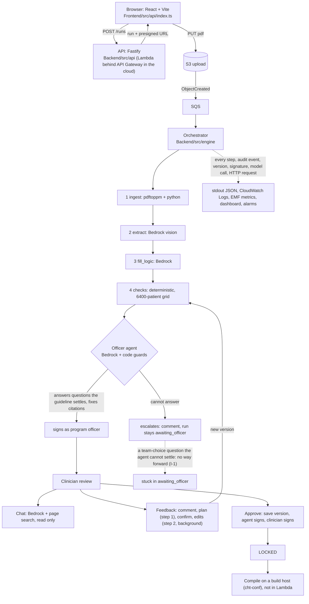

# End-to-end stress test: single source of truth

Run on 2026-11-04 against branch `main` (7226c5b) plus the uncommitted working-tree changes listed in section 7. The first full run found the approval path blocked; the later runs include the fixes made because of it, so both are kept (section 5).
Harness: `Backend/scripts/stress/` (`run.ts`, `lib.ts`). Raw results: `Docs/stress-results/*.json`. This document is the
interpretation; if it disagrees with the JSON, the JSON wins and this file is stale.

| File | What it is |
|---|---|
| `00-dev-local-fake-agent.json` | Sign-off chain on the team's `dev:local` (fake model, fake agent). 13/13 pass. |
| `01-before-agent-prompt-fix.json` | First full run with real Claude, **before** the officer-agent changes. 81 pass, 3 findings. |
| `02-final-real-claude.json` | **Final full run**, all areas, real Claude, 6 concurrent runs. 85 pass, 0 fail, 2 findings. |
| `03-signoff-chain-all-6-runs.json` | The sign-off chain on all 6 runs at once: 5 of 6 reach LOCKED. |

## 1. Verdict

| | |
|---|---|
| **Can a guideline go from PDF to LOCKED with the real AI officer agent?** | **Yes for 5 of 6 runs, after the fixes made in this test. 0 of 6 before** (issue I-1). The sixth stops on an entry-limits question that is the team's choice. On the hand-written draft only; see I-2. |
| **Does everything else hold up under load and hostile input?** | **Yes, on the code paths that ran.** Final run: 85 pass, **0 fail**, 2 findings, in 154 s. |
| **How good is the real AI draft?** | **Much worse than the hand-written draft every dev run uses.** 45 blocking findings versus 14 (I-2). One sample. |
| **What was NOT tested?** | Everything that needs AWS resources: DynamoDB, S3, SQS, Lambda, API Gateway, EventBridge. Also real PDF reading (ingest/extract). Section 6. |
| **Cost** | About $0.56 of Bedrock for the final 154 s run (151k input, 7k output tokens), about $0.07 for one real draft, a few dollars for the whole session. |

Read sections 4 (issues) and 6 (not covered) before trusting a green result anywhere else.

## 2. How to re-run

```
# terminal 1: a backend (real Bedrock, in-memory storage). Needs AWS credentials with Bedrock access in the environment.
cd Backend && npm run dev:local            # team's server: FAKE model + fake officer agent, port 8787
# or the real-model variant used for this report (see "Backend variant" below), port 8080

# terminal 2: the stress test
cd Backend
BASE=http://localhost:8080 LOG=/path/to/backend.log RUNS=6 npx tsx scripts/stress/run.ts
# CHAIN=skip  skip the sign-off chain      CHAIN=only  run pipeline + the sign-off chain on EVERY run, and report how many lock
# Exit prints PASS / FAIL / FINDING / INFO per check; results are written to stress-results.json (OUT=...).
```

**Backend variant used for the real-Claude runs.** `npm run dev:local` fakes the model, so it cannot show agent or chat
behaviour. The real-model server for this report was a local script (not committed) that builds the same objects as
`src/index.ts` (real orchestrator, API, officer agent, revision service, chat, logger) with in-memory store and artifacts and
a real Bedrock client. Its `ingest` and `extract` steps return the committed outputs for the public cough booklet and its
`fill_logic` step returns the committed hand-written draft, unless `FILL=real`. **Porting this into `Backend/scripts/` is
recommended** so the real-model run is reproducible from the repo (open item, section 8).

## 3. The workflow, and what each stage was tested with



| Stage | Code | How tested here | Result |
|---|---|---|---|
| Upload, create run | `api/server.ts`, `Frontend/src/api` | Browser upload of the real PDF; 6 concurrent API uploads | Works. Presigned URL replaced by a local PUT endpoint, so S3 itself was **not** exercised. |
| ingest, extract | `steps/ingest.ts`, `steps/extract.ts` | **Not exercised.** Committed outputs substituted. | Unknown for real PDFs at load. |
| fill_logic | `steps/fillLogic.ts` | Canned draft in all load runs; **one real run** | Works (25 s, 11k in, 2.2k out, $0.066) but the draft is poor (I-2). |
| checks | `steps/checks.ts`, `validation/` | Every run, every saved version | Works. Deterministic. About 250 ms. |
| Officer agent | `agent/officerAgent.ts` | 6 concurrent real-Claude runs, and again after every saved version | Stays inside its guards. Round 1 never signs by itself (0/6); after the clinician's save it signs 5/6 (I-1). |
| Chat | `chat/`, `api/clinicianRoutes.ts` | 15 checks incl. off-topic, injection, load, rate limit | Passes after two fixes (I-3). |
| Feedback loop | `revision/` | 10 checks incl. double confirm, stale plan, injection | Passes. Conservative: clinical threshold changes are deferred, not applied (I-9). |
| Version races | `versions/saveVersion.ts` | 8 parallel saves on one parent | 1 wins, 7 get 409. **Against the in-memory store only** (I-6). |
| Sign-off and lock | `signoff/` | Full chain on the fake-agent server and on 6 real-agent runs | Chain correct (13/13 fake; 5/6 real runs lock). Hazard test: a clinician answering an officer-routed question is refused for good (I-14). |
| Logging and monitoring | `observability/`, `Infra/lib/monitoring.ts` | Log inspection after the run; CDK synth and assertions | Logs complete and clean. **Dashboard and alarms never deployed** (I-8). |

## 4. Issue register

Severity: **Critical** blocks the product goal. **High** wrong behaviour users will hit. **Medium** real risk, narrower. **Low** polish.
Status: **Open** needs a decision or work. **Fixed (uncommitted)** fixed in the working tree during this test, with tests.

| ID | Sev | Status | Issue |
|---|---|---|---|
| I-1 | **Critical** | **Mitigated (uncommitted); residual decision open** | With the real officer agent, no run could reach LOCKED (0/6). Now 5/6 do. |
| I-2 | **High** | **Open** | The real AI draft has 45 blocking findings; every dev run uses a much better hand-written draft. |
| I-3 | High | Fixed (uncommitted) | Chat returned HTTP 500 when the model answered off-format; off-topic questions were treated as errors. |
| I-4 | Medium | Fixed (uncommitted) | The activity feed never showed why the officer agent escalated. |
| I-5 | Medium | Open, unverified in the cloud | Synchronous chat and revision step 1 are exposed to API Gateway's 30 s limit. |
| I-6 | Medium | Open, **untested** | DynamoDB atomic writes never exercised (36 tests skipped). |
| I-7 | Medium | Open | Chat rate limit is per process, not per user. |
| I-8 | Medium | Fixed (uncommitted), not deployed | A model-error alarm would have fired on every refused question. Dashboard and alarms undeployed. |
| I-9 | Low | Open (product note) | Clinical change requests produce plans but no edits. |
| I-10 | Low | Open | No authentication; role and user come from the request body. |
| I-11 | Low | Open | Cloud CORS default allows only `http://localhost:5173`. |
| I-12 | Low | Open | Oversized request body can end as a connection reset rather than a readable 413. |
| I-13 | Low | Open | Frontend: misleading approve header, 60 s blocking wait, no tests, favicon 404. |
| I-14 | High | Fixed in the UI (uncommitted) | The UI offered officer-routed questions to the clinician; answering them blocks a version for good. |
| I-15 | High | Fixed in the UI (uncommitted) | After an AI revision, the clinician's earlier answers were lost and a new question had no way to be answered. |

### I-1 (Critical, mitigated): the real officer agent could not do its job

**First finding (01 run).** 0 of 6 runs reached the clinician stage, and the clinician's approval died with *"Version 2 was saved, but
the officer agent has not signed it"* after about 60 s of spinning. My first reading was "a policy dead end: nobody can answer
officer-routed questions". That was **incomplete**. Reading the agent's own audit events showed the real cause:

| Agent fix attempts (real Claude) | Before | After tightening its instructions |
|---|---|---|
| Patch refused by the guard (touched fields it may not change) | 8 | 1 |
| Patch did not apply (`path not found`) | 4 | 0 |
| Patch saved as a new version | **3** | **12** |

- **Guard refusals (8).** The agent targeted exactly the right four questions (Q2 page reference, Q7 follow-up window, Q8 entry
  limits, Q14 publisher and edition), but tried to *record* the answer by inventing fields
  (`/open_questions/6/task_window_days_after_due`), writing `/meta/guideline/publisher` and `/edition` (not on the allowlist,
  `guard/patchPaths.ts`) and rewriting a citation in the same patch. The guard is all-or-nothing and a refusal is final, so one
  disallowed operation cancelled the whole fix. The guard behaved as designed; the agent was never told where the line is.
- **Did not apply (4).** It wrote `replace /open_questions/N/resolution`, but an open question has no `resolution` key yet and
  JSON Patch `replace` needs the key to exist. It must use `add`.
- **Fix (in `agent/officerAgent.ts`, prompt only; the guard is unchanged and still enforces everything).** Tell the agent to write
  exactly two operations per answered question (`replace` status, `add` resolution), to put the whole answer in the resolution text,
  never to add other fields or touch `/meta`, and not to touch citations unless a finding names them.
- **Result.** Round 1 still ends in escalation for every run (0/6): Q8 and Q14 are not settled by the cited pages, so the agent
  correctly leaves them open. But when the clinician saves a reviewed version the agent gets a fresh round, answers what it can,
  saves a newer version and signs it; the clinician then signs and the version locks. **5 of 6 runs reached LOCKED** (`03-...json`);
  the sixth stayed blocked on Q8 (entry limits are the team's choice). Post-lock behaviour is correct: no further signatures,
  and an edit creates a new unsigned version while the locked one stays releasable.
- **Why nobody saw it.** `npm run dev:local` fakes the agent's model so it answers every officer question with a fixed sentence.
  With that fake the whole chain locks, and the unit tests use the same fakes.
- **DEC-038 says to revisit "if the first runs show the agent escalating too often".** This is that evidence: before the change
  the agent failed 12 of 15 attempts.
- **Residual decision (policy, not mine to make).** A question that is the team's choice (Q8 entry limits, sometimes Q14) can never be
  settled by the agent, and a person cannot answer officer-routed questions over HTTP (`403 agent_only`, DEC-038). Such a run
  stays `awaiting_officer` with no way forward. Options: (1) a human program officer path (needs the Cognito work, DEC-015);
  (2) route team-choice questions to the clinician when the draft is written (`logic/fill/resolve.ts` creates them as
  `program_officer`); (3) allow the clinician's answer to count after an explicit, audited agent escalation (changes the AR rules,
  needs the BRD owner); (4) let the agent propose answers that the clinician confirms.

### I-2 (High): the real draft is far worse than the draft used everywhere in dev

One real `fill_logic` run (Claude Sonnet 4.5 via Bedrock) against the same extraction, same checks:

| | Hand-written draft (dev default) | Real Claude draft |
|---|---|---|
| Blocking findings (officer view) | 14 (all open questions) | **45** |
| Golden test cases failing | 0 | **20** |
| Rules, outcomes | 7, 7 | 5, 5 |
| Other blockers | none | use-before-ask 4, age groups 2, danger-sign coverage 2, severity order 2, number grounding 1 |

The officer agent only fixes citations, hashes and question bookkeeping, so it cannot repair logic defects like these, and
a real draft escalates even before I-1 applies. **Caveat:** one sample, and the golden case set is marked "proposed, awaiting
Medic" (DEC-020), so some failures may be the cases rather than the draft. Run `npm run fill:live` several times before
drawing conclusions about draft quality. What is certain: every green result in dev is on the hand-written draft.

### I-3 (High, fixed): chat 500 and off-topic handling

- Before: Claude answered an off-topic question ("weather in Seattle") in plain words, the backend expected JSON, and the user
  saw `The backend assistant could not answer: internal (/runs/.../chat)` followed by a help-text dump. In the load test one
  on-topic chat also returned 500 (model wrote a sentence plus a fenced block plus extra text).
- After: the chat prompt has a fixed refusal; a plain-text model answer with no JSON is shown as the reply with no citations;
  `extractJsonReply` (`model/strands.ts`) takes the first valid JSON in a reply (whole reply, else first valid fenced block,
  else bare JSON after a sentence) and the strict schema still validates it; the UI shows one short sentence for real failures.
  Final run: 15/15 chat checks pass, 0 unhandled 5xx. The 500 did not reproduce in 10 retries afterwards, so confidence is
  good but not total; failures now log their shape (length, fence count) without content.
- The strict parser `parseModelJson` and its tests are unchanged on purpose (ERR-017 records that fences are refused by design).

### I-4 (Medium, fixed): escalation reason missing from the activity feed

`officerAgent.ts` writes the cause under `why`; `activity/describe.ts` read `reason`, so the feed always showed the generic
sentence. Now reads `why` (and `reason` for old records). The new `officer_agent_refused_paths` audit event is mapped to a
plain sentence with no paths.

### I-5 (Medium, unverified): API Gateway's 30 s limit

Chat is synchronous and may loop up to 3 tool rounds; revision step 1 is synchronous. Measured here, with no Lambda cold start:
chat p50 5.6 s and max 6.7 s with 12 in parallel; step 1 4.2 s; model call p95 8.1 s. That is a 4x margin on this guideline.
Not measured: Lambda cold start of a 2 GB image with the Web Adapter, Bedrock throttling under real concurrency, longer guidelines.
Mitigation if it bites: make chat asynchronous like revision step 2, or show a clear timeout message.

### I-6 (Medium, untested): DynamoDB atomicity has never run

`tests/store/dynamoStore.test.ts` is `describe.skipIf(!DYNAMODB_ENDPOINT)`; those 36 tests are skipped in every run, and `.github/workflows/ci.yml` does not set the variable either. The properties that matter most (one-winner version numbers, the signature transaction
that locks, leases) were therefore checked only against the in-memory store, including my 8-way race test. Close with DynamoDB
Local (needs Docker, which was not running) and `DYNAMODB_ENDPOINT=http://localhost:8000 npx vitest run tests/store`, then point
this harness at a deployed stack.

### I-7 (Medium): chat rate limit is per process

`guard/rateLimit.ts` is an in-memory token bucket. On Lambda each instance has its own, so the effective limit is per
container. Locally it works (15 of 45 requests were refused at 30 per minute, and users are isolated). The durable cost cap
(`chat_budget_exceeded`, computed from the audit log) still bounds spend.

### I-8 (Medium): monitoring that would have misled

`observeModel` first logged every bad-format answer as `model.error`, and the `ModelError` alarm has threshold 0, so it would
have fired on each refused question. Now bad-format answers log `model.invalid_output` (warning, shape only) and the metric
`ModelOutputInvalid`; `ModelError` is reserved for real call failures. The dashboard and the 7 alarms exist in the CDK, pass
synth and assertion tests, and have **never been deployed**; the alarms have no notification target.

### I-9 to I-13 (Low)

- **I-9.** A feedback request to change a clinical threshold produced a plan that defers to a human (`needs_clinical_decision`)
  and added a question; 0 edits. Correct and safe, but users will think feedback "does nothing". Say so in the plan text, or point
  them to the Edit tab.
- **I-10.** No authentication; `role` and `userId` come from the body (known seam, DEC-015). Anyone who can reach the API can
  claim to be the clinician. Chat and injection tests cannot sign or lock; direct HTTP callers can claim any non-reserved identity.
- **I-11.** `Infra` default `uiOrigins` is `http://localhost:5173`, which on this machine is another app; the project UI ran on
  5174 to 5176. A deployed API would block it until `uiOrigins` includes the real origin.
- **I-12.** A 6 MB body to `POST /versions` returned 413 on one run and a reset connection (client sees "fetch failed") on another.
  The server closes the socket mid-upload. A browser would show a network error instead of "too large".
- **I-13.** Frontend: the review header claims checks pass and every question is answered while officer questions are unsatisfiable;
  approval blocks 60 s polling; `/favicon.ico` is a 404; the frontend has no automated tests (only the build, lint and my
  browser runs); the chat history sent to the backend is capped at 12 messages and 1,500 characters each.

### I-14 (High, fixed in the UI): the UI let clinicians poison a version

An answer to an officer-routed question that is saved by the clinician is booked as `OPEN_QUESTION_WRONG_RESOLVER`, and
`validation/checks/openQuestions.ts` states that "a later version cannot launder it". Harness check T-82 confirms it: the clinician's
version stayed `awaiting_officer` with 2 wrong-resolver blockers and the agent could not clear them. **I introduced the exposure**:
my change opens an escalated run to the clinician, and the review screen then listed all 14 questions, including the officer's, with
"Keep as drafted". Fixed in `Frontend/src/domain/workflow.ts` (`flagsFrom(model, live)`): in live mode the clinician is offered only
clinician-routed questions. The backend still accepts the bad save (the hazard is a backend rule the UI must respect), so any other
client can still trigger it; consider refusing such a save with a clear error instead of booking it silently.

### I-15 (High, fixed in the UI): a revision stranded the clinician

Found by walking the demo path in the browser after the harness was green (the frontend has no automated tests, which is how it got through).
After a feedback round the AI can add an open question for a human. The review then said "1 question for you" and disabled Approve, but
the question had no card in the chat (cards were only created when a draft was first loaded), and loading the backend's new version also
discarded the answers the clinician had already given. Fixed in `Frontend/src/domain/workflow.ts` (`replaceFromBackend`): earlier answers
are carried into the new version, and a card is added for every new question. Feedback is also refused while there are unsaved local edits,
because the AI's version would replace them. Verified in the browser: 13 earlier answers kept, new question Q18 shown, then approve to LOCKED.

**Demo note.** On this guideline the AI almost never *applies* a feedback edit. The extraction offers only 4 thresholds, 3 follow-ups
and a few actions, and the code refuses ungrounded edits. Example: asked to swap a follow-up, the AI proposed exactly the right edit and the
safety rule refused it because that follow-up has no schedulable timing. The visible outcome of feedback is therefore a plan plus a new
question for the human, which is the intended guardrail behaviour. The UI now shows the refusal reason instead of a bare code.

## 5. Results by area (final run `02-...json`: 85 pass, 0 fail, 2 findings, 5 info; 154 s; 6 concurrent runs)

| Area | Checks | What it proves |
|---|---|---|
| P pipeline under load | 5 | 6 runs at once all reach the officer stage in about 1.7 s (canned stages; 2 to 3 s in other runs). Every step ran exactly once, no duplicates. Activity feed complete. |
| A officer agent | 3 | Agent finished every run (signed or escalated), none timed out. Round 1: 0/6 signed on its own (finding, see I-1). State matches outcome. |
| C API contract and hostile input | 38 | 37 malformed or hostile requests all got the right 4xx, never 5xx: bad JSON, bad types, oversized, traversal ids, reserved author, wrong role, stale sha, hidden routes `/events` and `/invocations` (404). 300 parallel reads: p95 under 1 s. |
| V version races | 3 | 8 simultaneous saves: exactly 1 created, 7 conflicts; version numbers stay unique and consecutive; every save ran the checks. In-memory store only (I-6). |
| H chatbot | 15 | Grounded answer with page citation ("50 breaths or more per minute", page 8). 4 off-topic questions refused. 4 prompt-reveal and injection attempts: no leak, nothing signed. Unicode and emoji. 12 parallel chats: all 200, max 6.7 s. Rate limit engaged, per user. |
| R feedback loop | 10 | Comment, plan (4.2 s), confirm, background edit (4.3 s). Double confirm gives one 202 and one 409. Plan from an old version gives 409 `not_latest`. Injection in a comment: severities unchanged, 7 rules stay 7, nothing signed. Token use per revision: about 1.2k + 3.5k in. |
| S sign-off | 7 | Real agent: clinician saves, agent saves a newer version and signs, stale-sha signature refused (409), clinician signs and the version locks, no further signatures, an edit after lock makes a new unsigned version while the locked one stays releasable. Across all 6 runs: 5 lock (`03-...json`). Fake agent: 13/13. |
| T hazard | 1 | A clinician-saved answer to an officer-routed question is permanently blocked (finding I-14). |
| O logging and monitoring | 10 | Every stdout line is JSON (2,461 lines, 410 per run). All 1,311 EMF metric lines valid (13 distinct metrics). Every step of every run logged at start and end. No unhandled 5xx. No comment, chat text, prompt or AWS secret in the logs (a canary string planted in a comment and a chat message was absent). 57 model calls, 0 errors, p50 3.3 s, p95 8.1 s. |

Browser (Playwright) checks, outside the harness: upload through the UI, run reaches Ready, review loads the backend draft,
Assistant answers a grounded question with a source line, off-topic refused, feedback plan with Confirm/Cancel, input box and
buttons laid out as designed; approve to LOCKED on the fake-agent server (verified on the backend afterwards); approve dead end
on the real-agent server before the agent fix (I-1).

## 6. What was NOT tested (do not assume these work)

| Not covered | Why | How to cover it |
|---|---|---|
| DynamoDB (5 tables, conditional writes, transactions, leases) | No tables; 36 tests skipped | DynamoDB Local with `DYNAMODB_ENDPOINT`; or deploy and run the harness against the API URL |
| S3 presigned upload, S3 to SQS event, DLQ | No bucket, no queue | Deploy (`DEPLOYMENT.md`); upload through the UI |
| Lambda container, Web Adapter, cold start, 15 min limit, async self-invoke for revision step 2, background work after the response | Not deployed; Docker was not running | Deploy and run with `BASE=<APIURL>`; watch `Duration` and `Errors` |
| API Gateway (30 s cut-off, throttling, CORS) | Not deployed | As above; set `uiOrigins` first |
| EventBridge 5 minute resume sweep, crash recovery of a cut-off run | Needs durable store and real Lambda | Kill the process mid-run on a deployed stack |
| Real `ingest` and `extract` on a PDF (pdftoppm, Bedrock vision over about 80 pages) | Canned outputs used to keep the test fast and cheap | `npm run fill:live` style run, or a harness mode that uploads a real PDF end to end |
| Real `fill_logic` at load | One real run only; others canned | `FILL=real RUNS=6` |
| Compile and release (cht-conf build host, synthetic check, IT approval) | Build host not built (DEC-014); the UI's release stage is simulated | Out of scope until the build host exists |
| CloudWatch dashboard, alarms, EMF ingestion | Never deployed | Deploy, trigger a failure, confirm an alarm and a metric |
| Bedrock throttling and quotas | 12 parallel calls, no 429 seen; real limits unknown | Raise concurrency until throttled; confirm `TransientError` retry behaviour |
| Browsers other than Chromium, mobile layout, accessibility | Not tried | Manual or Playwright matrix |
| Soak (hours), memory growth | 134 s only | Long run with periodic uploads |

## 7. Changes made during this test (uncommitted, all with tests)

| Change | Files |
|---|---|
| Observability: structured logs, EMF metrics, store and model decorators, request logging | `Backend/src/observability/`, `src/index.ts`, `src/api/server.ts` |
| CloudWatch dashboard and 7 alarms | `Infra/lib/monitoring.ts`, `lambda-stack.ts`, `bin/app.ts` |
| Chat: off-topic refusal, plain-text reply handling; UI input and error text | `Backend/src/chat/chat.ts`, `Frontend/src/components/Chat.tsx`, `src/api/index.ts` |
| Frontend chat and feedback wired to the backend | `Frontend/src/api`, `actions.ts`, `App.tsx`, `domain/` |
| JSON extraction from fenced or sentence-prefixed model replies | `Backend/src/model/strands.ts` |
| Revision step 2 sends only the revision-relevant part of the fill prompt (about 27% fewer input tokens) | `Backend/src/revision/engine.ts` |
| Officer agent: exact patch shape for answering a question, explanation length rule, refused-paths audit event (fix attempts that save: 3 of 15 before, 12 of 13 after) | `Backend/src/agent/officerAgent.ts` |
| UI offers the clinician only clinician-routed questions in live mode (I-14) | `Frontend/src/domain/workflow.ts` |
| Activity feed: escalation reason, refused-paths line | `Backend/src/activity/describe.ts` |
| Invalid-output metric split from model errors | `Backend/src/observability/observe.ts` |
| This harness and its saved results | `Backend/scripts/stress/`, `Docs/stress-results/` |

Suites on the final code: backend 1647 passed (36 skipped, see I-6), infra 77 passed and `cdk synth` succeeds, frontend typecheck,
build and lint (0 errors) clean. The frontend has no automated tests.

## 8. Open items, in priority order

1. **Decide the residual of I-1**: who answers an officer-routed question the agent cannot settle (team-choice items like entry limits). Until then a run with such a question can never lock.
2. **Measure I-2 properly**: run `fill:live` repeatedly, separate bad draft from bad golden cases, decide whether the officer agent needs logic-fix powers. Every green result above is on the hand-written draft.
3. **Close I-6**: run the 36 skipped DynamoDB tests, then deploy and point this harness at the real API.
4. **Port the real-model dev server into `Backend/scripts/`** so this report is reproducible from the repo alone.
5. Decide whether the backend should refuse a clinician save that answers an officer-routed question (I-14) instead of booking it silently.
6. Deploy monitoring and add an SNS target to the alarms (I-8); fix the review header and the 60 s blocking approve (I-13); set `uiOrigins` (I-11).
